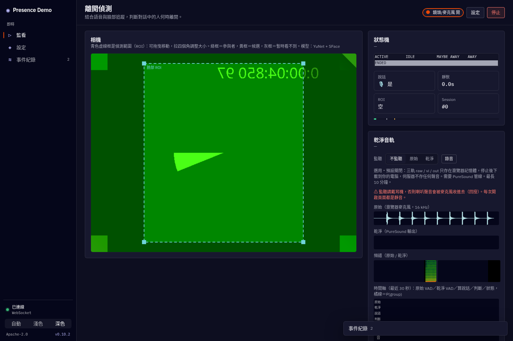

# Presence Demo：偵測對話中的使用者是否離開

> 私人專案 · All rights reserved（未授權任何使用、複製或散布）

結合**影像**（人臉偵測、人臉 embedding、群組追蹤，可選的姿勢與距離）和**聲音**（瀏覽器端 VAD），判斷正在跟機器人對話的人（或一群人）是不是已經離開。包含 Python 核心模組（純邏輯、可單元測試）和 FastAPI + WebSocket 網頁 demo。



## 功能

- **群組追蹤**：每個人一個 track（IoU + cosine 比對、EMA 更新 embedding），任何一位參與者還在就不算離開；被擋住有寬限期；換成一群陌生人時觸發 **NEW_GROUP**。
- **狀態機**：`ACTIVE → IDLE → MAYBE_AWAY → AWAY → ENDED`，含防閃爍遲滯，每次轉換都記錄原因。
- **判斷優先模式**：`vision`（預設）／`balanced`／`audio`，可另設 `present_max_silence`。
- **VAD 融合**：瀏覽器端能量 VAD，把說話狀態送給伺服器一起判斷。
- **人臉模型**：OpenCV YuNet（偵測）+ SFace（embedding），CPU 執行；模型無法下載時改用 Haar + HSV 直方圖備援。
- **姿勢（選用）**：MoveNet MultiPose Lightning（最多 6 人），提供身體框、關鍵點和朝向；看不到臉時用身體判斷有人；轉身且遠離時可提早進入 MAYBE_AWAY。
- **距離（選用）**：用臉寬／肩寬估計距離，含對話區、離開距離、靠近／遠離趨勢和網頁一鍵校正。
- **分開的 ROI**：臉部 ROI（藍）和身體 ROI（紫）可在畫面上拖曳，並設定判定規則。
- **設定介面**：分組設定抽屜、預設組合、伺服器端範圍檢查、localStorage 自動保存、JSON 匯出入。
- **資源監控**：CPU、記憶體、各階段延遲 avg/p95、fps、頻寬、RTT、跳過比例、姿勢耗時。
- **開始／停止**：停止時真正關閉鏡頭與麥克風；切換分頁自動暫停。
- **效能最佳化**：移動偵測閘門、embedding 節流、自適應 fps、ROI 裁切＋縮小，可個別開關（見 [PERFORMANCE](docs/PERFORMANCE.md)）。
- **隱私**：影像只在記憶體中解碼處理，**不寫入磁碟**（`tests/test_privacy.py` 檢查）；embedding 只存在記憶體，ENDED 時清除。
- **存取權杖**：設定 `PRESENCE_TOKEN` 後，頁面、API、WebSocket 都需要 `?token=`。

## 快速開始

需要 [uv](https://docs.astral.sh/uv/) 和 Python ≥ 3.10。

```bash
uv sync
export PRESENCE_TOKEN="$(python -c 'import secrets;print(secrets.token_urlsafe(16))')"  # 選用，對外開放時必設
uv run presence-demo                      # http://127.0.0.1:8000/?token=<PRESENCE_TOKEN>
uv run presence-demo --host 0.0.0.0 --port 8000
```

- 瀏覽器只有在 localhost 或 HTTPS 下才允許使用鏡頭和麥克風。
- 模型在第一次使用時下載到 `models/`（可用 `PRESENCE_MODEL_DIR` 指定）：YuNet、SFace；開啟姿勢時再下載 MoveNet。
- 權杖只從環境變數讀取，請勿寫進檔案或提交。
- `PRESENCE_FACE_EMBEDDER=hist`：不載入 SFace，改用 HSV 直方圖。

## 開發與測試

```bash
uv run ruff check . && uv run ruff format --check .
uv run pytest -q
uv run python scripts/benchmark.py        # 60 秒模擬情境，比較各最佳化、姿勢、距離的 CPU 成本
```

## 專案結構

```
presence_demo/
  tracker.py     Config、群組追蹤、狀態機（純邏輯）
  vision.py      YuNet / SFace / Haar 備援、MoveNet 姿勢偵測、記憶體內解碼
  body.py        身體朝向、臉與身體配對、距離估計與校正
  optimizer.py   移動閘門、embedding 節流、ROI 裁切、自適應 fps
  stats.py       資源與延遲統計
  server.py      FastAPI + WebSocket、權杖中介層
  static/index.html  網頁 demo（設定、監控、ROI、骨架疊圖）
scripts/benchmark.py
tests/           單元、WebSocket、隱私、姿勢／距離測試
docs/            文件
```

## 文件

- [docs/ARCHITECTURE.md](docs/ARCHITECTURE.md)：架構、資料流、狀態機
- [docs/CONFIGURATION.md](docs/CONFIGURATION.md)：所有參數、範圍、預設值、預設組合
- [docs/TUNING.md](docs/TUNING.md)：調參方法
- [docs/PERFORMANCE.md](docs/PERFORMANCE.md)：效能最佳化與基準測試
- [docs/LICENSES.md](docs/LICENSES.md)：模型、套件、測試資料的授權
- [CONTRIBUTING.md](CONTRIBUTING.md)、[CHANGELOG.md](CHANGELOG.md)

## 授權

- 第三方元件的授權與商用風險見 [docs/LICENSES.md](docs/LICENSES.md)（不是法律意見）。
- **SFace 的權重標示 Apache-2.0，但訓練資料可能有非商業限制**，商用前請先確認，或用 `PRESENCE_FACE_EMBEDDER=hist` 停用。
- 本專案：私人專案，All rights reserved。未經作者書面同意，不得使用、複製、修改或散布。
