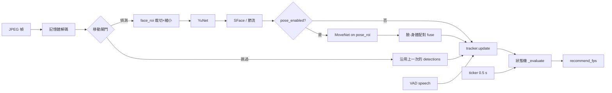
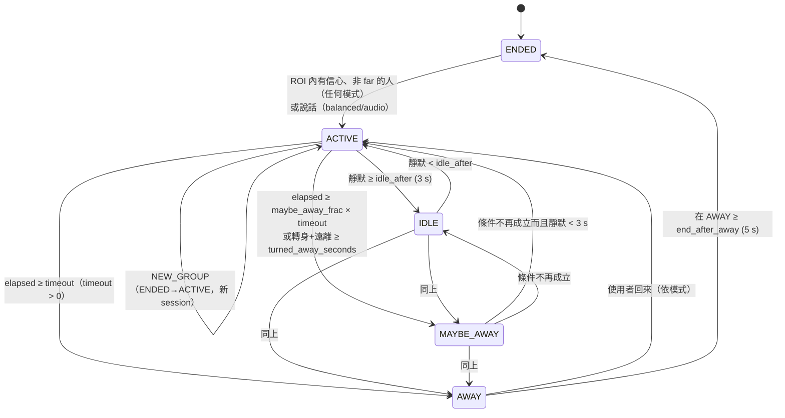

# 偵測邏輯詳解（依目前程式碼，v0.7.0）

> 依據 `presence_demo/tracker.py`、`vision.py`、`optimizer.py`、`body.py`、`server.py`、`static/index.html` 的現行程式碼整理。括號內是預設值。座標都是正規化 0–1。

## 0. 總覽：一個 WebSocket 連線裡發生什麼

- 瀏覽器端：
  - 每 `1000/fps` ms 送一張 JPEG（高 480 px、品質 0.7），附帶目前的 `speech` 旗標。
  - VAD 狀態改變時立即送 `{type:'vad'}`。
- 伺服器端的 worker 只處理**最新一張**：處理中又進來的幀會覆蓋舊的，計為 dropped。
  1. 處理前記錄 `stable = state ∉ {MAYBE_AWAY, AWAY}`。
  2. 在記憶體中解碼 → `FrameProcessor.process()` → `tracker.update(dets, speaking)` → 計算建議 fps → 回傳 state。
- ticker 每 0.5 s 呼叫一次 `tracker.tick()`（等於 `_evaluate`）。所以就算沒有新的幀，計時也會繼續走，狀態照樣轉換。
- 按停止或重設會建立新的 `PresenceTracker`（track 和 embedding 全部清掉），`FrameProcessor` 也一起重設。



## 1. 每一幀的處理流程（`FrameProcessor.process`）

1. **解碼**：`cv2.imdecode`，只在記憶體中，不寫入磁碟。
2. **移動偵測閘門**（`motion_gate`=開）：
   - 把畫面轉灰階、縮成 64×48，和上一張比，`diff = mean|Δ| / 255`。
   - 以下條件**全部**成立才跳過偵測，直接沿用上一次的 detections（含身體）：
     - `motion_gate` 開；
     - `stable`（目前不在 MAYBE_AWAY 或 AWAY）；
     - 已經有上一次的結果；
     - `diff < motion_threshold`（0.015）；
     - 距離上次完整偵測 `< force_detect_seconds`（3 s）。
   - 第一張幀的 diff 視為 1.0，所以一定會做偵測。
   - 被跳過的幀照樣送進 tracker，track 的 `last_seen` 一樣會更新。
3. **ROI 裁切＋縮小**（`roi_crop`=開）：
   - 裁切範圍是 `face_roi`（0.2, 0.05, 0.8, 0.95）往外加 `crop_margin`（0.1），夾在畫面內。
   - 寬度大於 `max_width`（320）時等比例縮小。
   - 偵測框和 5 個特徵點會換算回原畫面座標。
4. **人臉偵測**：
   - YuNet 本身的 score 門檻是 0.5（`FaceDetectorYN.create(..., 0.5, nms 0.3, top 50)`）。
   - `min_conf`（0.6）在 tracker 裡才使用，用來把 detection 分成「有信心」和「低信心」。
   - 沒有模型時改用 Haar：信心 ≈ 權重 / 5，上限 1。
5. **Embedding 節流**（`embed_throttle`=開）：
   - 每張臉從快取中找 IoU 最大的上一筆。
   - 以下條件全部成立才**重用**上一筆的 embedding：
     - 上一筆有 embedding；
     - IoU > 0.3；
     - 中心位移和大小變化都不超過 `embed_move_thresh`（0.15，相對上一筆的框）；
     - 距離上次計算 `< embed_interval`（3 s）；
     - 上次計算時的自我相似度 `self_sim ≥ cos_match`（0.40）。
   - 其他情況就重新計算（SFace 在縮小後的裁切圖上 alignCrop）。
   - 重新計算時，如果上一筆 IoU > 0.3，就把新舊 embedding 的 cosine 記成 `self_sim`。
6. **姿勢**（`pose_enabled`=關）：
   - 只有完整偵測的幀才跑。
   - MoveNet MultiPose 在 `pose_roi`（整個畫面）上執行：開了 `roi_crop` 時加 `crop_margin`；不縮小，模型內部把長邊縮到 256。
   - 丟掉信心 `< pose_conf`（0.4）的人。
   - 關鍵點信心門檻：
     - 朝向、肩寬用 0.5；
     - 髖用 0.3；
     - 頭部框、配對用 0.3。
7. **臉和身體配對**（`fuse` / `associate`）：
   - 配對條件：臉中心落在身體框內（上緣可以再往上 5%），而且：
     - 有鼻子或眼睛時：臉中心到這些點平均位置的距離 ≤ 臉寬（取寬高較大者）；
     - 沒有鼻子或眼睛時：臉中心在身體框上方 40% 以內。
   - 符合的組合依「臉中心到頭部框中心的距離」由小到大貪婪配對。
   - 沒配到身體的臉：保留為只有臉的 detection。
   - 沒配到臉的身體：用 `head_box`（頭部關鍵點，或身體框頂部）當 bbox，`conf` 取身體信心，**沒有 embedding**。
8. **距離估計**（在 tracker 的 `_update_body` 中，`distance_enabled`=關）：
   - 基本公式：`d = W / (w · 2·tan(HFOV/2))`，其中 HFOV 是 `camera_hfov`（60°），w 是正規化後的寬度。
   - 臉：W=0.15 m，w 是臉框寬。
   - 肩：W=0.38 m，w 是肩寬，**只在 facing=「facing」時使用**。
   - 有兩個估計時取平均，再乘 `distance_calib`（1.0），用 `distance_ema`（0.3）平滑。
   - `far = distance_enabled 而且 distance > leave_distance`（2.5 m）。
   - 校正：取目前看得到、原始距離最近的人，`calib = 已知距離 / 原始距離`（範圍限制在 0.2–5），並重設所有 EMA。

## 2. 追蹤（`_match`）

- 只有**在 ROI 內**（見 §3）而且有信心的 detection 會參與比對；低信心的 detection 不會更新 track。
  - 有臉的 detection：`conf ≥ min_conf`（0.6）。
  - 只有身體、沒有臉的 detection：`conf ≥ body_min_conf`（0.4）。
- 每一幀開始時，所有 track 先設成 `visible=False`。
- 一組 detection × track 符合下列**任一**條件就是候選：
  - `cos ≥ cos_match`（0.40）；
  - `IoU ≥ iou_match`（0.3）而且 `cos ≥ cos_weak`（0.20）；
  - `IoU ≥ iou_match` 而且任一方沒有 embedding（只有身體的情況）。這時 IoU 取「頭部框 IoU」和「身體框 IoU」的較大值。
- 分數 = `cos + 0.5·IoU`，由高到低貪婪一對一配對。
- 配對成功時：
  - 更新 bbox、conf、`last_seen`，設 `visible=True`；
  - 更新身體、朝向、大小趨勢、距離；
  - embedding 用 EMA 更新：`norm((1−0.15)·舊 + 0.15·新)`；track 原本沒有 embedding 時直接採用新的。
  - 如果不是參與者，而且離上次看到超過 2.5 s，重設 `in_roi_since`（重新計算加入時間）。
- 沒配對到的 detection：建立新 track（`in_roi_since=now`），記錄 `track_new` 事件。
- 大小趨勢：
  - 有身體時用身體框高度，否則用臉寬，保留最近 12 筆。
  - 和至少 1.5 s 前最近的一筆比：比值 `< 1−recede_ratio`（0.9）是 receding，`> 1.1` 是 approaching，其他是 steady。
- **移除**：`now − last_seen > grace_seconds`（15 s）的 track 會被刪除（`track_drop`）。參與者也一樣。

### 2b. kalman 追蹤模式（`tracker_mode=kalman`，`_match_kalman`）

預設是上面的 legacy。kalman 模式的完整說明和評估見 [TRACKING.md](TRACKING.md)。

1. **預測**：每個 track 的 Kalman 濾波器（狀態是 cx、cy、w、h 和它們的速度）用實際的 `dt` 預測到現在。
2. **門檻篩選**（任一條件成立就不配對）：
   - Mahalanobis² > `gate_mahalanobis`（9.21），而且 IoU < `iou_match`，臉部 cosine 也沒有達到 `cos_match`；
   - 兩邊都有臉，但 cosine < `cos_weak`；
   - 沒有臉，而且衣服相似度 < `appearance_min_sim`（0.6）。
3. **分數**：有資料的項目做加權平均：
   - IoU（預測框或身體框）×1；
   - 移動一致性 `exp(−m²/gate)` ×1；
   - 臉 `min(1, cos/cos_match)` ×2；
   - 衣服 `(sim−0.5)/0.5` ×1.5。
   
   分數 ≥ 0.3 才可以配對；代價 = 1 − 分數。
4. **匈牙利演算法**：求全域最佳配對。配對成功時用偵測結果更新 Kalman，再套用和 legacy 相同的更新（bbox、身體、embedding EMA、距離），衣服模板用 `appearance_ema`（0.2）更新。
5. **預測延續**：沒配對到而且消失 ≤ `coast_seconds`（2 s）的 track：
   - bbox 改成預測框，`visible_kind=predicted`，`vis_conf = 1 − 消失秒數／coast_seconds`；
   - `visible = vis_conf ≥ coast_present_conf`（0.4）。
   
   超過 `coast_seconds` 就是 `none`。
6. **對其他規則的影響**：
   - 預測中而且 visible 的 track 會讓「有人」繼續成立。它不會增加 `present_streak`，但會延後 ROI 空的判定，`first_empty_at` 從預測結束後的第一張空幀開始算。
   - 預測中的 track 不能加入成參與者，也不算 NEW_GROUP 的 newcomer。
   - 在「舊群組是否消失」的判斷中，它算是可見。
7. **衣服描述子**：只在 kalman 模式時，由 `FrameProcessor` 在記憶體中計算。軀幹區域優先用肩膀和髖部的關鍵點，其次用身體框，最後用臉下方的區域。

所有模式的 snapshot 都多了 `visible_kind`、`vis_conf`、`dwell_seconds`、`velocity`（legacy 模式下 `velocity` 是 null）。

## 3. 參與者規則

- **ROI 規則**（`det_in_roi`，看框的中心點）：
  - `pose_enabled` 關，或 `roi_rule="face"` → 只看臉中心是否在 `face_roi` 內。只有身體的 detection 不算在內。
  - `roi_rule="body"` → 只看身體框中心是否在 `pose_roi` 內。
  - `"either"`（預設）→ 兩者任一成立即可。
  - 不在 ROI 內的 detection 會被整個丟掉，連「低信心」也不算。
- **加入**：一個 track 成為參與者要同時滿足：
  - `visible`、不是 `far`，而且目前還不是參與者；
  - `now − in_roi_since ≥ join_seconds`（2 s），**或**符合「說話立即加入」（`speech_join`，見下方）；
  - 目前沒有正在計時的 NEW_GROUP（`_newgroup_since is None`）；
  - 舊群組沒有全部消失，或根本還沒有參與者。
- **說話立即加入**（`speech_join`=auto）：聲音沒有位置資訊，所以預設很保守。
  - `auto`：vision 模式等於 `off`，balanced／audio 模式等於 `single_candidate`。
  - `off`：說話不會讓人立即加入，一律等 `join_seconds`。
  - `single_candidate`：目前正在說話，而且只有**一位**可見、非 far 的候選人；他的臉在 `face_roi` 內、朝向是 facing（沒有身體資料時視為 facing）；開啟距離時距離 ≤ `zone_max`。
  - `all`：所有可見候選人立即加入（v0.4.0 以前的行為）。
- **距離區**（只用來顯示）：
  - `> leave_distance` → left；
  - `< zone_min`（0.4）→ near；
  - `≤ zone_max`（2.0）→ in；
  - 其他 → far。
  - 真正影響判斷的只有 `far`（`> leave_distance`）：far 的人不能加入，也不算「有人」。所有可見的人都超出距離時，記錄一次 `far` 事件。

### 3b. 互動意圖模式（`intent_model=score`，`_update_intent`）

預設是上面的 rules。score 模式的規則：

- 每個 track 的意圖分數（0–1）= 各線索的加權平均，乘上面向閘門，再用實際 dt 做 EMA。線索有：
  - 面向：YuNet 五點＋肩膀；
  - 距離：沒開距離估計就略過；
  - 停留、走近、沒在路過、ROI 中央；
  - 可歸屬的說話。
- **加入**：意圖 ≥ `join_threshold` 持續 `join_seconds`，取代「待滿 join_seconds」和 `speech_join`。
- **開始 session**：ENDED 時同樣要有人達到加入條件；balanced／audio 模式的說話仍可開始。
- **降為旁觀者**：意圖 < `drop_threshold` 持續 `drop_seconds`，而且有看到他；最後一位參與者不會被降級。
- **NEW_GROUP**：新候選人要達到加入條件。
- **在場（hmm）**：群組 P 只看參與者；還沒有參與者時只看意圖達門檻的 track。

詳細說明見 [INTENT_MODEL.md](INTENT_MODEL.md)。

## 4. 影像狀態：有人／空／不確定（`_update_presence`）

這一幀的輸入：
- `near`：有任何 visible 而且不是 far 的 track。
- `low`：ROI 內有低信心的 detection。

依序判斷：

| 條件 | 動作 |
|---|---|
| `near` | `present_streak += 1`，`empty_streak = 0` |
| 不是 near，但有 `low` | `present_streak = 0`，`low_streak += 1`；`low_streak ≥ absent_frames`（3）時記錄 `uncertain` 事件，`present=False`、`empty=False` |
| 兩者都沒有 | `empty_streak += 1`，`present_streak = 0`；這是第一張空幀時記下 `first_empty_at = now` |
| `present_streak ≥ present_frames`（2），或（`near` 而且本來就 present） | `present=True`，`empty=False` |
| `empty_streak ≥ absent_frames`（3） | `present=False`、`empty=True`；`empty_since = first_empty_at`（第一張空幀的時間，和 fps 無關） |
| `low` 而且不是 near、目前不是 present | 立刻 `empty=False`（變成不確定） |

判斷路徑（path）：
- `present=True` → **present**；
- `empty=True` 而且 `empty_since` 有值 → **empty**；
- 其他 → **uncertain**。

## 5. 聲音（瀏覽器 VAD）

- AnalyserNode 的 fftSize 是 1024，每 50 ms 計算一次 RMS。
- 門檻：`thr = max(noise_floor × vad_k, vad_min)`，預設 `vad_k` 2.5、`vad_min` 0.005。
- 噪音底初始值 0.01：
  - 說話中：`floor = 0.999·floor + 0.001·rms`；
  - 沒說話：`floor = 0.95·floor + 0.05·rms`；
  - 下限 1e-4。
- `rms > thr` 時，把 `until` 設成 `now + vad_hang`（400 ms）；`speech = now < until`。
- 送進伺服器的兩條路：
  - 狀態改變時送 `vad` 訊息 → `set_speech()`：更新 `speaking`，說話時更新 `last_speech`，然後立即 `_evaluate`。
  - 每張幀也帶 `speech` → `update(..., speaking)`，效果相同。
- 靜默時間 = 正在說話時為 0，否則為 `now − last_speech`。

## 6. 狀態機（`_evaluate`）



### 每次評估的順序

1. 狀態是 ENDED → 什麼都不做。
2. 依模式和 path 決定 `timeout` 和 `elapsed`（見下表）。
3. 狀態是 AWAY：
   - `returned` 成立 → ACTIVE（「user returned」）；
   - 否則在 AWAY 已經 `≥ end_after_away`（5 s）→ ENDED；
   - 然後結束這次評估（AWAY 不會跳到 MAYBE_AWAY）。
4. `timeout > 0` 而且 `elapsed ≥ timeout` → **AWAY**。
5. 否則，如果「轉身提早」成立 → **MAYBE_AWAY**：
   - 轉身計時已持續 `≥ turned_away_seconds`（2 s），而且目前沒有在說話。
6. 否則，`timeout > 0`、`elapsed ≥ maybe_away_frac × timeout`（0.5），而且不屬於「vision 模式、path=present、靜默 < idle_after」的情況 → **MAYBE_AWAY**。
7. 否則，靜默 `< idle_after`（3 s）→ **ACTIVE**；其他 → **IDLE**。

MAYBE_AWAY 沒有自己的遲滯：條件一消失，下一次評估就回到 ACTIVE 或 IDLE。

### 各模式的 timeout 與 elapsed（預設值）

| 模式＼path | present | empty | uncertain |
|---|---|---|---|
| **vision** | timeout=`present_max_silence`（0 = 關）→ **不會因靜默離開**；開啟時 elapsed=靜默 | timeout=`empty_timeout` 5 s，elapsed=已經空了多久（**不管聲音**）→ 2.5 s MAYBE、5 s AWAY | base 20 s、elapsed=靜默 → 10 s MAYBE、20 s AWAY |
| **balanced** | `present_timeout` 15 s、靜默 → 7.5 / 15 s | `empty_timeout` 5 s、elapsed=min(靜默, 空的時間) → 2.5 / 5 s | base 20 s、靜默 → 10 / 20 s |
| **audio** | 1.5×base = 30 s、靜默 → 15 / 30 s | 0.5×base = 10 s、靜默 → 5 / 10 s | 1.0×base = 20 s、靜默 → 10 / 20 s（下限 1 s） |

### 其他規則

- **轉身提早 MAYBE_AWAY**（`turned_away_early`=開）：
  - 所有可見而且不是 far 的參與者都滿足：facing 是 side 或 away，**而且** trend 是 receding。
  - 條件成立時開始計時並記錄 `turned_away` 事件；條件一不成立就重設計時。
  - 只能進到 MAYBE_AWAY；真正的 AWAY 仍然由 timeout 決定。
  - facing 判定：
    - 分數 = 0.35（有鼻子）+ 0.25（兩眼都有）+ 0.2（左肩在畫面右側）+ 0.2×min(1, 肩寬／軀幹高 ÷ 0.6)；
    - ≥ 0.6 是 facing，≥ 0.3 是 side，其他是 away；
    - 只有臉、沒有身體時當作 facing。
- **從 AWAY 恢復**：
  - vision 模式 → **只有 `present` 才算回來**；單靠說話永遠不會恢復（包括 path 是 uncertain 時）。
  - balanced、audio → `speaking or present`。
- **ENDED**：
  - 進入時清空所有 track 和 embedding，設 `present=False`、`empty=True`。
  - 重新開始（`_start`）：
    - `update()`：ROI 內有**有信心而且不是 far** 的人（任何模式；far 用這一幀的距離估計判斷）；或在 balanced／audio 模式下正在說話。
    - `set_speech(True)`：只在 balanced／audio 模式。
  - 重新開始時 session +1，所有狀態重設：`empty=True`、`empty_since=now`、`last_speech=now`。

### 6b. 在場機率模式（`presence_model=hmm`，`_hmm_update`／`_evaluate_hmm`）

預設是上面的 rules。hmm 模式下，第 4 節的計數和本節的逾時表都不使用：

- 每個 track 存一個對數勝算 L，每張幀加上 `rate × dt`，並限制在 P = 0.02–0.98 之間。rate 的來源：
  - 偵測到：`+detect_gain × conf`；
  - 預測中：較弱；
  - 低信心幀：接近中立；
  - 沒看到：每 `leave_halflife` 秒勝算減半；
  - 轉身＋遠離、超出距離：往「離開」推。
- 群組 P = sigmoid(參與者最大 L + 聲音證據 A)。A 的權重依 priority_mode：vision 幾乎是 0，balanced 中等，audio 最高。
- 狀態判斷：
  - P < `p_away` 持續 `away_hold_seconds` → AWAY；
  - P < `p_maybe`（或已經在 MAYBE_AWAY 且 P < `p_active`）→ MAYBE_AWAY；
  - 否則依靜默時間 → ACTIVE／IDLE。
- AWAY 時 P ≥ `p_active` → ACTIVE（vision 只看影像的 P）；AWAY 持續 `end_after_away` → ENDED。
- NEW_GROUP：舊參與者的 P 都 < `p_away`，而且新候選人的 P ≥ `p_active`。
- 加入規則不變。

詳細說明見 [PRESENCE_MODEL.md](PRESENCE_MODEL.md)。

## 7. NEW_GROUP（`_check_new_group`，只在不是 ENDED 時檢查）

- 條件：
  - 舊群組消失：有參與者，沒有任何參與者 visible 且不是 far，**而且有確定的證據**（這一幀有有信心的 detection，或 ROI 已確認是空的）。只有低信心的幀不算舊群組消失。
  - **而且**有 newcomer：不是參與者、visible、**不是 far**，而且 `now − in_roi_since ≥ join_seconds`（2 s）。
- 條件第一次成立時開始計時 `_newgroup_since`；條件中斷就重設。
- 持續 `≥ new_group_seconds`（3 s）時：
  1. 記錄 `NEW_GROUP` 事件；
  2. 結束目前 session（清空 track）並開始新的 session（ACTIVE）；
  3. 把 newcomer 保留成新的參與者（保留原本的 id 和 embedding），設 `present=True`。
- 計時期間 newcomer 不能加入成參與者。所以從新的人出現算起，最快大約 2 + 3 = 5 s 換組。
- 換組只看身分（embedding）比對失敗。舊參與者回來時，只要能比對回原本的 track，計時就會中斷。

## 8. 自適應 fps（`recommend_fps`，`adaptive_fps`=開）

- 只在處理完一張幀後計算，ticker 不會計算。
- 回傳 `fps_high`（2）的情況（任一）：
  - 狀態是 MAYBE_AWAY 或 AWAY；
  - 3 s 內 track 組合有變（id、participant、visible 的簽章改變）；
  - 有候選人（visible 但不是參與者）；
  - 有參與者暫時不可見（還在 grace 期間）。
- 其他情況回傳 `fps_low`（0.5），包括 ENDED、ACTIVE、IDLE 穩定時。
- 瀏覽器在 `adaptive_fps` 開啟而且建議值 > 0 時採用建議值；否則使用自己的 `fps`（1）。

## 精簡判斷流程

```
每幀: 解碼 → [閘門: 靜止&穩定&<3s → 沿用] → 裁切縮小 → YuNet → SFace(可重用) → [姿勢→配對]
     → ROI 規則篩選 → 有信心才追蹤（臉 0.6／只有身體 0.4） → 比對/新建/加入/移除(grace 15s)
     → present(連續2) / empty(連續3) / uncertain(低信心)
     → NEW_GROUP 檢查 → _evaluate
_evaluate: ENDED? 跳過
         AWAY? 回來→ACTIVE；滿 5s→ENDED
         elapsed≥timeout → AWAY
         轉身+遠離≥2s 且沒說話 → MAYBE_AWAY
         elapsed≥0.5×timeout → MAYBE_AWAY
         靜默<3s → ACTIVE，否則 IDLE
```

## v0.4.1 已修正

- `empty_since` 改成記錄第一張空幀的時間，不再假設 1 fps。
- 只有身體的 detection 改用 `body_min_conf`（0.4）。
- far 的人不會從 ENDED 開始 session，也不會成為 NEW_GROUP 的 newcomer。
- 說話立即加入改成 `speech_join`（vision 模式預設關閉）。
- vision 模式下，說話不會從 AWAY 恢復（包括 uncertain 時）。
- `present_timeout` 的說明修正。
- `_low_streak` 在新 session 時重設。
- 只有低信心的幀不算「舊群組消失」。
- snapshot 新增 `face_roi`、`pose_roi`（保留 `roi` 當作 `face_roi` 的別名）。

## 目前已知的限制

（下列是 legacy 預設模式下的限制；kalman 模式另外有約 1 s 的離開判定延遲，見 TRACKING.md。）

1. **`present_timeout`（15 s）比 `base_timeout`（20 s）短**：這是使用者選定的預設值。在 balanced 模式下，有人在場時反而比影像不確定時更快判定離開，和 audio 模式（有人時 ×1.5）方向相反。需要時請調高。
2. **新 session 一開始的 path 是 empty**：`present_frames`=2 要第二張幀才會變成 present。
   - vision 模式下，第一張和第二張幀之間會用 `empty_timeout` 計時。
   - 幀間隔大於 2.5 s 時（例如網路很慢），可能短暫進入 MAYBE_AWAY。
3. **第 6 步的排除條件幾乎不會生效**：「vision 而且 present 而且靜默 < idle_after」只有在 `present_max_silence > 0`，而且它的一半小於 3 s 時才有作用。
4. **連續低信心時，參與者在畫面上顯示為不可見**：建議 fps 會變成 high。不過已經不會因此觸發 NEW_GROUP 或阻擋加入。
5. **移動閘門沿用的結果仍然更新 `last_seen`**：如果人離開的動作很小（diff < 0.015），最多要等到下一次強制偵測（≤ `force_detect_seconds` 3 s）才會發現。
6. **轉身提早只看參與者**：沒有參與者時（例如還在 join 期間），不會觸發轉身提早。
7. **`single_candidate` 仍然無法確認是誰在說話**：只是把風險降到「只有一個人可能是說話者」的情況。
