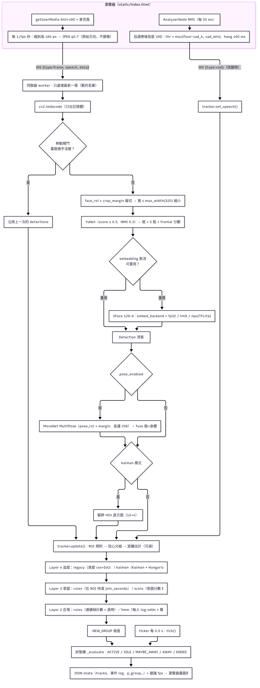
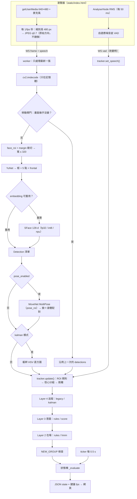
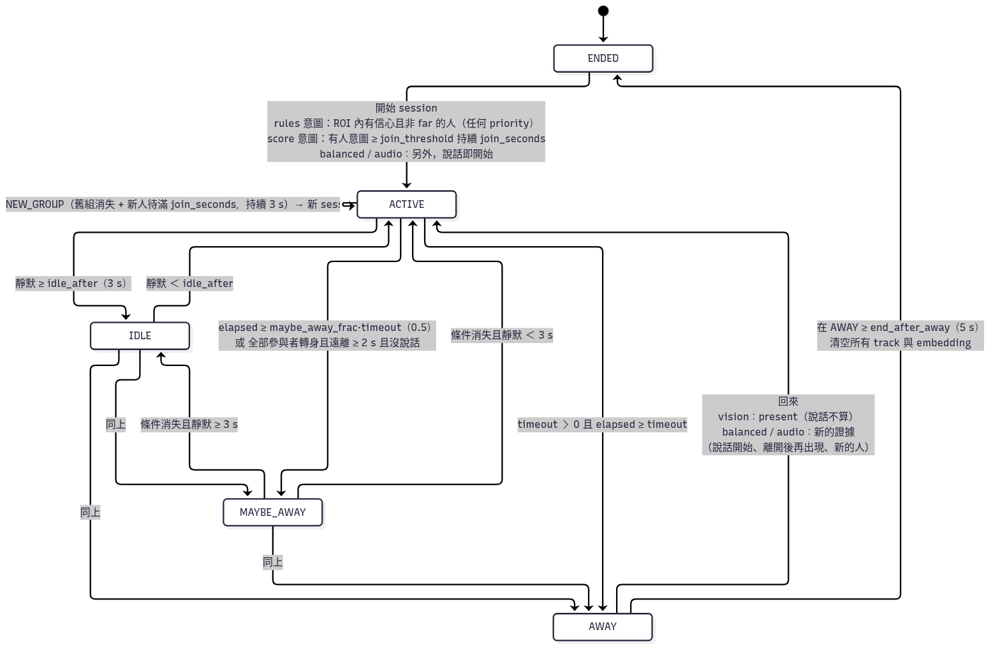
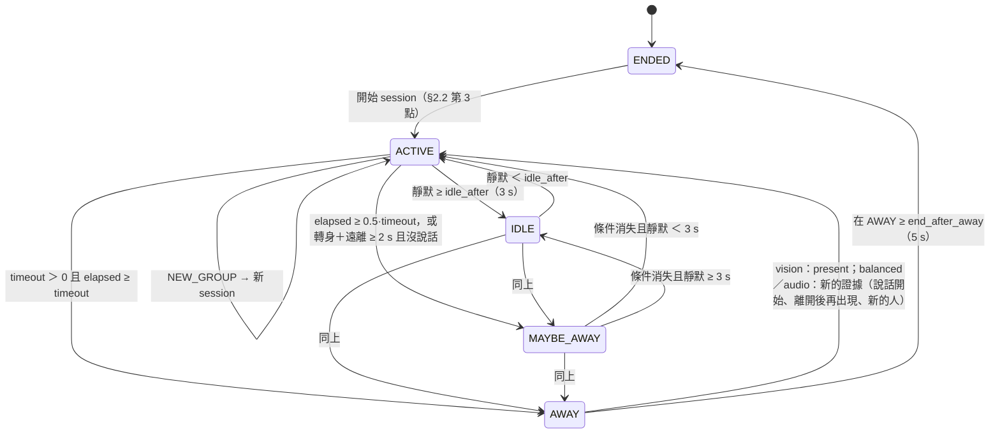
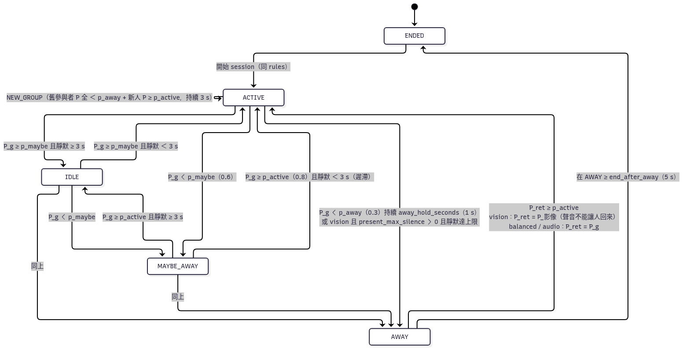
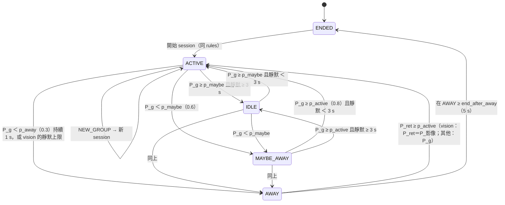
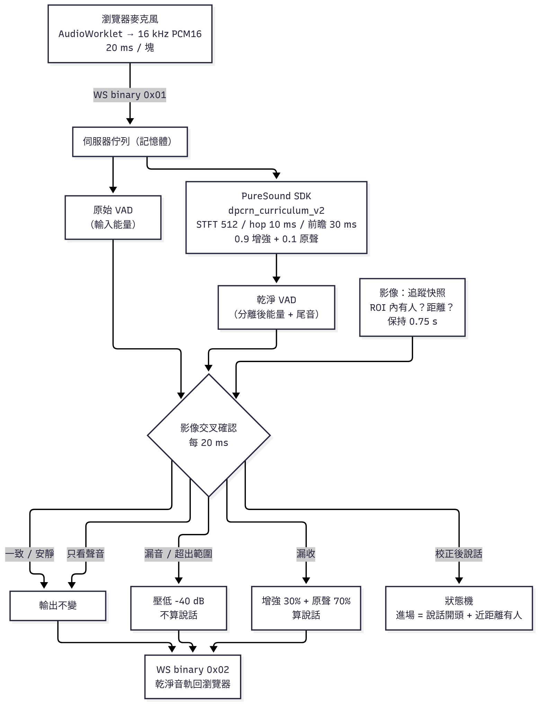

# 演算法架構總覽（v0.8.2）

> 這份是**總文件**：完整說明目前程式碼實作的演算法，從瀏覽器擷取畫面到最後的狀態輸出。內容依據 `presence_demo/` 下的 `tracker.py`、`optimizer.py`、`vision.py`、`embed_backends.py`、`body.py`、`appearance.py`、`kalman.py`、`intent.py`、`presence_model.py`、`server.py` 和 `static/index.html` 整理，所有預設值都已經和 `Config` 核對過。
>
> 細節請看各層的文件：[TRACKING.md](TRACKING.md)（Layer 4 追蹤）、[INTENT_MODEL.md](INTENT_MODEL.md)（Layer 3 意圖）、[PRESENCE_MODEL.md](PRESENCE_MODEL.md)（Layer 2 在場）、[NPU.md](NPU.md)（嵌入後端／NPU）、[CONFIGURATION.md](CONFIGURATION.md)（所有參數）、[PERFORMANCE.md](PERFORMANCE.md)（效能）、[LICENSES.md](LICENSES.md)（授權）。
>
> 寫法約定：座標都是正規化 0–1 的 `(x0, y0, x1, y1)`，而且是**原始相機座標**（網頁的鏡像顯示只影響畫面）。時間單位是秒。`參數名`（預設值）。

## 目錄

1. [端到端資料流](#1-端到端資料流)
2. [各層說明](#2-各層說明)（感知 → 追蹤 → 意圖 → 在場 → 群組決策 → 狀態機 → 輸出）
3. [priority_mode 對各層的影響](#3-priority_mode-對各層的影響)
4. [模式矩陣與建議預設](#4-模式矩陣與建議預設)
5. [時間表：各種事件需要多久](#5-時間表各種事件需要多久)
6. [效能、隱私與授權](#6-效能隱私與授權)
7. [已知限制與尚未在實機驗證的項目](#7-已知限制與尚未在實機驗證的項目)

---

## 1. 端到端資料流

（原始檔：[img/dataflow.mmd](img/dataflow.mmd)。下面是同一張圖的 mermaid 版本，GitHub 會直接渲染。）

### 1.1 連線與排程（`server.py`）

| 項目 | 實作 |
|---|---|
| 驗證 | 設定 `PRESENCE_TOKEN` 時，HTTP 和 WebSocket 都要帶 `?token=`，否則 403／1008。access log 關閉（避免 token 進 log）。 |
| 每個連線 | 一個 `PresenceTracker`（各自的 `Config`）、一個 `FrameProcessor`、一組統計。YuNet／SFace 的 `VisionPipeline` 和 MoveNet 是**整個行程共用**。 |
| 送幀 | 瀏覽器每 `1000/fps` ms 送一張：把影片縮到高 480 px（640×480 鏡頭就是 640×480），JPEG 品質 0.7，附帶目前的 `speech`。 |
| 只處理最新一張 | worker 正在處理時又收到的幀會覆蓋上一張待處理的幀（計為 dropped），所以延遲不會累積。 |
| 時鐘 | ticker 每 0.5 s 呼叫 `tracker.tick()`（只跑狀態機），所以沒有新的幀時計時一樣會走；每 1 s 送一次資源統計。 |
| 停止／重設 | 建立新的 `PresenceTracker`、重設 `FrameProcessor`：所有 track 和 embedding 都清掉。 |
| 分頁切到背景 | 網頁自動停止（關鏡頭和麥克風），切回來時自動恢復。 |

### 1.2 聲音（瀏覽器 VAD）

每 50 ms 取一次 1024 點的 RMS $r$：

$$
\text{thr}=\max(f\cdot \texttt{vad\_k},\ \texttt{vad\_min}),\qquad
f \leftarrow \begin{cases}0.999f+0.001r & r>\text{thr}\\ 0.95f+0.05r & \text{其他}\end{cases},\quad f\ge 10^{-4}
$$

- `vad_k`（2.5）、`vad_min`（0.005）、噪音底初始值 0.01。
- $r>\text{thr}$ 時把 hang 計時器設成 `vad_hang`（400 ms）；`speech = 還在 hang 時間內`。
- 傳到伺服器有兩條路：狀態改變時送 `vad` 訊息（`set_speech()` 會立即評估狀態機）；每張幀也帶著 `speech`。
- 靜默時間：$s = 0$（正在說話），否則 $s = \text{now} - \text{last\_speech}$。
- 聲音**沒有位置資訊**，所以不會直接歸到某一個人身上（例外見 §2.4 的 `speech_join` 和 §2.5 的說話線索）。

---

## 2. 各層說明

### 2.1 Layer 1：感知（`optimizer.FrameProcessor.process`、`vision.py`）

#### (a) 移動閘門（`motion_gate`=開）

把畫面轉灰階、縮成 64×48，和上一張比：

$$
\Delta=\frac{1}{64\cdot 48}\sum_{i}\frac{|g_t(i)-g_{t-1}(i)|}{255}
$$

以下條件**全部**成立時跳過偵測，直接沿用上一次的 detections（包含身體和外觀）：

- $\Delta <$ `motion_threshold`（0.015）；
- `stable`：處理前的狀態不是 MAYBE_AWAY 或 AWAY；
- 已經有上一次的結果；
- 距離上次完整偵測 $<$ `force_detect_seconds`（3 s）。

第一張幀的 $\Delta$ 當作 1。被跳過的幀仍然會送進 tracker（track 會照樣更新 `last_seen`）。

#### (b) ROI 裁切和縮小（`roi_crop`=開）

- 人臉偵測只在 `face_roi`（0.2, 0.05, 0.8, 0.95）往外加 `crop_margin`（0.1）的範圍內進行，範圍限制在畫面內。
- 裁切後的寬度如果大於 `max_width`（320），就等比例縮小，縮放比例 $k=\min(1, 320/w_\text{crop})$。
- 偵測框和 5 個特徵點會換算回原畫面座標：$x = x'/k + x_0$。
- 姿勢偵測用的是 `pose_roi`（預設整個畫面）加 margin，**不縮小**（MoveNet 內部會把長邊縮到 256）。

#### (c) YuNet 人臉偵測

- `cv2.FaceDetectorYN`：score 門檻 0.5，NMS 0.3，最多 50 張臉。每張臉輸出框、5 個特徵點（右眼、左眼、鼻子、兩個嘴角）和信心值。
- 正面分數（從特徵點計算，Layer 3 使用）：

$$
\text{frontal}=\operatorname{clip}\!\left(1-\frac{|n_x-(r_x+l_x)/2|}{0.5\,|l_x-r_x|},\,0,\,1\right)
$$

- 沒有 YuNet 模型時改用 Haar（信心值約為權重／5）；那時 embedding 改用 HSV 直方圖（備援，辨識力很弱）。

#### (d) SFace embedding 和節流

- 先用 5 個特徵點做相似轉換對齊成 112×112，再算出 128 維特徵並做 L2 正規化。比對用 cosine：$\cos(a,b)=a\cdot b$。
- embedding 是在**裁切縮小後**的影像上計算的。
- **後端**（`embed_backend`，見 [NPU.md](NPU.md)）：

  | 值 | 模型 | 執行 | 比對門檻 |
  |---|---|---|---|
  | `fp32`（預設） | SFace ONNX | OpenCV DNN CPU | `cos_match`（0.40） |
  | `int8` | opencv_zoo 官方 int8 ONNX（檢查 sha256） | OpenCV DNN CPU | `cos_match_int8`（0.40） |
  | `npu` | 本機匯出的 TFLite：`npu_precision`=`int8`（全整數）或 `fp16` | LiteRT。有設定 `PRESENCE_NPU_DELEGATE`（只能用伺服器的環境變數設定）時載入外部 delegate，失敗或沒設定就用 CPU XNNPACK。沒有 delegate 而且要求 int8 時，自動改用 fp16 模型（在 CPU 上比較快）。 | int8 用 `cos_match_int8`，fp16 用 `cos_match` |

  模型不存在時退回 fp32，並在資源面板顯示原因。
- **節流**（`embed_throttle`=開）：每張臉從快取裡找 IoU 最大的上一筆。以下條件全部成立時就**重用**上一筆的 embedding：
  - IoU $> 0.3$；
  - 中心位移和大小變化（相對上一筆的框）都 $\le$ `embed_move_thresh`（0.15）；
  - 距離上次計算 $<$ `embed_interval`（3 s）；
  - 上次計算時的自我相似度 `self_sim` $\ge$ `cos_match`。

  重新計算時，`self_sim` 是新舊 embedding 的 cosine。

#### (e) MoveNet 姿勢（`pose_enabled`=關）

- 使用 MoveNet MultiPose Lightning（TFLite fp16，LiteRT 4 個執行緒），最多 6 人，輸出 COCO-17 關鍵點。
- 只在完整偵測的幀上執行；捨棄信心 $<$ `pose_conf`（0.4）的人。
- **臉和身體配對**（`fuse`）：
  - 條件：臉的中心落在身體框內（上緣可以再往上 5%），而且臉中心到鼻子／眼睛平均位置的距離 $\le$ 臉寬；沒有鼻子和眼睛時，改成臉中心在身體框上方 40% 以內。
  - 符合條件的組合依照距離由近到遠貪婪配對。
  - 沒配到臉的身體會變成「只有身體」的 detection：用 `head_box` 當作 bbox，沒有 embedding。
- **朝向**分數：

$$
o = 0.35[\text{鼻}] + 0.25[\text{雙眼}] + 0.2[\text{左肩在畫面右側}] + 0.2\min\!\left(1,\frac{\text{肩寬}/\text{軀幹高}}{0.6}\right)
$$

  - $o \ge 0.6$ 是 facing，$\ge 0.3$ 是 side，其他是 away。
  - 只有臉、沒有身體時視為 facing（分數 1）。

#### (f) 外觀描述子（只在 `tracker_mode=kalman` 時計算）

- 取軀幹區域（優先用肩膀和髖部的關鍵點，其次用身體框，最後用臉下方的區域），計算 HSV 色彩直方圖（H 12 格 × S 4 格），再做 L1 正規化。
- 相似度用 Bhattacharyya 係數：$\text{BC}(a,b)=\sum_i\sqrt{a_ib_i}$。

#### (g) 距離估計（`distance_enabled`=關，在 tracker 的 `_update_body` 中計算）

針孔相機模型，$w$ 是正規化後的寬度：

$$
d=\frac{W}{w\cdot 2\tan(\text{HFOV}/2)}\cdot k_\text{calib}
$$

- 臉：$W$ = `face_width_m`（0.15 m）；肩：$W$ = `shoulder_width_m`（0.38 m），**只在 facing 時使用**。兩者都有時取平均。
- `camera_hfov` 是 60°，$k_\text{calib}$ 是 `distance_calib`（1.0）。
- 用 EMA 平滑：$d_t=(1-0.3)\,d_{t-1}+0.3\,d$（`distance_ema` 0.3）。
- `far = distance > leave_distance`（2.5 m）。far 的人不能開始 session、不能加入、也不算 NEW_GROUP 的新人；hmm 模式下會往「離開」推。
- 距離區（`zone_min` 0.4、`zone_max` 2.0）主要用來顯示，score 模式也會當作意圖線索。
- 校正：取原始距離最近的可見者，$k=\text{已知距離}/d_\text{raw}$。

### 2.2 進入 tracker 前的篩選（`PresenceTracker.update`）

1. **ROI 規則**（`roi_rule`=either，看框的中心點）：
   - `pose_enabled` 關，或 `roi_rule=face`：臉中心要在 `face_roi` 內；
   - `roi_rule=body`：身體中心要在 `pose_roi` 內；
   - `either`：兩者任一成立即可。
   
   ROI 外的 detection 直接丟掉，連「低信心」都不算。
2. **信心分組**：有臉的 detection 門檻是 `min_conf`（0.6），只有身體的是 `body_min_conf`（0.4）。高於門檻是「有信心」，低於門檻是「低信心」。只有有信心的 detection 會參與追蹤；低信心的 detection 只影響在場判斷（變成「不確定」）。
3. **開始 session**（狀態是 ENDED 時）：
   - `intent_model=rules`：ROI 內有**有信心、非 far** 的人（任何 priority）；
   - balanced／audio：正在說話也可以開始（`set_speech(True)` 也一樣）；
   - `intent_model=score`：只有當某個 track 達到意圖加入條件時才開始（路人不會開始 session）。開始時保留現有的 track。

### 2.3 Layer 4：追蹤（`_match`／`_match_kalman`，詳見 [TRACKING.md](TRACKING.md)）

**比對門檻**：`match_cos` 用 `cos_match`（0.40）；量化後端（int8，或 npu 的 int8）用 `cos_match_int8`（0.40）。`cos_weak`（0.20）。`iou_match`（0.3）。

#### legacy（預設）：貪婪比對

一組 detection 和 track 符合下列**任一**條件就成為候選：

$$
\cos\ge \texttt{match\_cos}\ \ \lor\ \ (\text{IoU}\ge 0.3 \land \cos\ge 0.20)\ \ \lor\ \ (\text{IoU}\ge 0.3 \land \text{任一方沒有 embedding})
$$

- 沒有臉時，IoU 取頭部框和身體框兩者的較大值。
- 分數 $=\cos+0.5\,\text{IoU}$，由高到低一對一貪婪配對。

#### kalman：Kalman + Hungarian + 外觀 + 預測延續

- **狀態**：$x=[c_x,c_y,w,h,\dot c_x,\dot c_y,\dot w,\dot h]$，等速模型，用實際的 $dt$ 預測：

$$
F=\begin{bmatrix}I_4 & dt\,I_4\\ 0 & I_4\end{bmatrix},\quad
Q=\begin{bmatrix}\tfrac{dt^4}{4}\Sigma_a & \tfrac{dt^3}{2}\Sigma_a\\ \tfrac{dt^3}{2}\Sigma_a & dt^2\Sigma_a\end{bmatrix},\quad
\Sigma_a=\operatorname{diag}(0.5^2,0.5^2,0.1^2,0.1^2)
$$

  量測雜訊 $R=\operatorname{diag}(0.01^2,0.01^2,0.015^2,0.015^2)$。
- **排除**（任一條件成立就不配對）：
  - 中心點的 Mahalanobis 距離平方 $m^2>$ `gate_mahalanobis`（9.21，χ² 2 自由度 99%），而且 IoU $<0.3$，而且臉部 cosine 沒有達到 `match_cos`（夠像的臉可以在任何位置重新認出）；
  - 兩邊都有臉，但 $\cos<$ `cos_weak`；
  - 沒有臉，而且外觀 $\text{BC}<$ `appearance_min_sim`（0.6）。
- **分數**：有資料的項目做加權平均，分數 $\ge 0.3$ 才能配對，代價 $=1-\text{score}$，用 Hungarian 演算法求全域最佳配對：

$$
\text{score}=\frac{1\cdot\text{IoU}+1\cdot e^{-m^2/9.21}+2\cdot\min(1,\cos/\texttt{match\_cos})+1.5\cdot\operatorname{clip}\!\left(\tfrac{\text{BC}-0.5}{0.5}\right)}{\sum \text{權重（只算有資料的項目）}}
$$

- **預測延續（coast）**：沒配到而且消失時間 $\le$ `coast_seconds`（2 s）的 track，框改成預測框，並設定：

$$
\texttt{vis\_conf}=1-\frac{\text{消失秒數}}{\texttt{coast\_seconds}},\qquad \texttt{visible}=\texttt{vis\_conf}\ge \texttt{coast\_present\_conf}\ (0.4)
$$

  也就是大約 1.2 s 內仍然算看得到。外觀模板用 `appearance_ema`（0.2）更新。

#### 兩種模式共用的部分

- 配對成功時：
  - embedding 用 EMA 更新：$e\leftarrow \text{norm}((1-0.15)e+0.15e_\text{new})$（`embed_ema` 0.15）；
  - 同時更新身體、朝向、大小趨勢和距離。
- 非參與者消失超過 2.5 s 後再被配到時，加入計時（`in_roi_since`）會重新開始。
- 沒配到的 detection 建立新的 track。
- `now − last_seen > grace_seconds`（15 s）的 track 會被刪除。
- **大小趨勢**：有身體時用身體框高度，否則用臉寬；和至少 1.5 s 前的值比較：比值 $<1-0.1$ 是 receding，$>1+0.1$ 是 approaching（`recede_ratio` 0.1）。

### 2.4 Layer 3：意圖和加入（詳見 [INTENT_MODEL.md](INTENT_MODEL.md)）

#### rules（預設）

- 加入條件：visible、這一幀**有偵測到**（不是預測）、不是 far、還不是參與者，而且：

$$
\text{now}-\texttt{in\_roi\_since}\ \ge\ \texttt{join\_seconds}\ (2\text{ s})\quad\lor\quad \text{說話立即加入}
$$

- **說話立即加入**（`speech_join`=auto）：vision 模式等於 `off`；balanced／audio 模式等於 `single_candidate`。`single_candidate` 的條件：正在說話，**只有一位**候選人，臉在 `face_roi` 內，朝向是 facing，開啟距離時還要 $\le$ `zone_max`。`all` 會讓所有候選人立即加入。
- 下列情況不能加入：NEW_GROUP 正在計時；或舊群組全部消失、但仍然有參與者時（這時應該走 NEW_GROUP）。

#### score

每個有偵測到的 track 每幀計算各個線索（0–1）：

| 線索 | 公式 | 權重（預設） |
|---|---|---|
| facing | 有臉：$f$ = frontal（沒有特徵點時用 0.85）；有姿勢：$0.5f+0.5o$；只有身體：$o$ | `w_facing` 0.45 |
| distance | $d\le$ `zone_max` 時是 1，到 `leave_distance` 線性降到 0；沒開距離估計時略過 | `w_distance` 0.10 |
| dwell | $\min(1, \text{在 ROI 的秒數}/4)$ | `w_dwell` 0.10 |
| approach | $\operatorname{clip}(0.5+4\,\dot s)$，$\dot s$ 是大小相對變化率（EMA，時間常數 1 s） | `w_approach` 0.05 |
| still | $\max(0,1-\lvert v_x\rvert/0.12)$，$v_x$ 是橫向速度（每秒畫面寬度；kalman 模式直接用濾波器的速度） | `w_still` 0.15 |
| center | $\max(0, 1-\sqrt{d_x^2+(0.5d_y)^2})$，相對 `face_roi` 中心和半寬高 | `w_center` 0.15 |
| speech | 正在說話，而且只有一位候選人，或他是唯一面向機器人（frontal $\ge 0.5$）的人時才給 1 | vision 0.05／balanced 0.15／audio 0.25 |

$$
r=\frac{\sum_k w_k c_k}{\sum_k w_k}\ (\text{只算有值的線索}),\qquad
r_g=r\,(1-0.5(1-c_\text{facing})),\qquad
I\leftarrow I+(r_g-I)\left(1-e^{-dt/\tau}\right)
$$

- $\tau$ 是 `intent_tau`（1 s）。新 track 的 $I$ 直接等於第一次的 $r_g$。
- 看不到的 track 不更新線索，$I$ 以 $4\tau$ 的時間常數慢慢降向 0。
- **加入**：$I\ge$ `join_threshold`（0.6）持續 `join_seconds`（2 s），取代 rules 的「待滿 2 s」和 `speech_join`。
- **降為旁觀者**：參與者在**看得到**的情況下 $I<$ `drop_threshold`（0.35）持續 `drop_seconds`（8 s），而且他不是最後一位參與者（離開與否由 Layer 2 判斷）。
- 例子（沒開距離估計）：
  - 正面、靜止、在中央的人：$r=0.775/0.9\approx0.86$，所以 2 s 後加入；
  - 側面（frontal 0.5）、以 0.2 畫面寬／秒走過、在 ROI 邊緣的人：$r_g\approx0.27$，不會加入；
  - 側站看熱鬧（frontal 0.3）、靜止待滿 4 s 的人：$r_g\approx0.37$，不會加入。

### 2.5 Layer 2：在場判斷

#### rules（預設，`_update_presence`）

這一幀的輸入：`near`（有偵測到、visible、非 far 的 track）、`low`（ROI 內有低信心的 detection）、`coasting`（kalman 模式下還在預測、visible 的 track）。

| 條件 | 動作 |
|---|---|
| `near` | `present_streak += 1`，`empty_streak = 0` |
| 不是 near，但有 `low` | `present_streak = 0`；連續 `absent_frames`（3）張之後設 `present = empty = False`（不確定） |
| 兩者都沒有 | `empty_streak += 1`；記下第一張空幀的時間（coasting 時不記） |
| `present_streak ≥ present_frames`（2），或 `near` 而且本來就是 present | `present = True` |
| `empty_streak ≥ absent_frames`（3），而且沒有在 coasting | `empty = True`，`empty_since` = 第一張空幀的時間（和 fps 無關） |

判斷路徑（path）：`present` → present；`empty` 而且有 `empty_since` → empty；其他 → uncertain。

**逾時表**（`maybe_away_frac` 0.5：elapsed 達到 timeout 的一半時進入 MAYBE_AWAY）：

| priority＼path | present | empty | uncertain |
|---|---|---|---|
| **vision** | timeout = `present_max_silence`（0 = 關）→ **不會因為靜默而離開** | `empty_timeout`（5 s），elapsed = 空了多久（**不管聲音**）→ 2.5 s MAYBE、5 s AWAY | `base_timeout`（20 s），elapsed = 靜默 → 10／20 s |
| **balanced** | `present_timeout`（15 s），elapsed = 靜默 → 7.5／15 s | `empty_timeout`（5 s），elapsed = min(靜默, 空了多久) → 2.5／5 s | `base_timeout`（20 s），elapsed = 靜默 → 10／20 s |
| **audio** | 1.5 × base = 30 s，elapsed = 靜默 → 15／30 s | 0.5 × base = 10 s，elapsed = 靜默 → 5／10 s | 1.0 × base = 20 s → 10／20 s |

**轉身提早**（`turned_away_early`=開，只在 rules 模式）：所有 visible、非 far 的參與者都是 side 或 away，**而且** trend 是 receding，持續 `turned_away_seconds`（2 s）而且沒有說話時 → MAYBE_AWAY（不會直接進入 AWAY）。

#### hmm（`_hmm_update`／`_evaluate_hmm`，詳見 [PRESENCE_MODEL.md](PRESENCE_MODEL.md)）

每個 track 有一個對數勝算 $L=\ln\frac{P(\text{在場})}{P(\text{離開})}$，每一幀依實際 $dt$（最多 3 s）積分：

$$
L\leftarrow \operatorname{clip}\big(L+\rho\cdot dt,\ \ln\tfrac{0.02}{0.98},\ \ln\tfrac{0.98}{0.02}\big),\qquad \lambda=\frac{\ln 2}{\texttt{leave\_halflife}}\ (0.6\text{ s} \Rightarrow 1.155/\text{s})
$$

| 這一幀的狀況 | $\rho$ |
|---|---|
| far | $-3\lambda$ |
| 有偵測到 | $+\texttt{detect\_gain}\cdot\text{conf}$（4 × conf）；轉身而且遠離時改成 $-\lambda$ |
| 預測中（kalman） | $-\lambda(1-\texttt{vis\_conf})$ |
| 只有低信心的幀 | $-\lambda\cdot\texttt{lowconf\_factor}$（0.15） |
| 完全沒看到 | $-\lambda$ |

- 新 track：$L=0+\rho\cdot0.5$（conf 0.9 時 $P\approx0.86$）。
- **影像機率** $P_\text{tr}$：參與者中最大的 $P$。還沒有參與者時用所有 track（score 模式只看意圖 $\ge$ 門檻的 track）。完全沒有 track 時：vision 模式是 0.02，其他模式是 0.5。舊參與者都 $<$ `p_away`，但有穩定的新人（$P\ge$ `p_active`、待滿 `join_seconds`）時，也把新人算進來（避免換組前先跳到 AWAY）。
- `intent_weighted_presence`（關）：開啟時，score 模式的 $P$ 會乘上 $\min(1, I/\texttt{join\_threshold})$。
- **聲音偏移**（只加在群組上，不歸到任何人）：

$$
A=\begin{cases} w_s(\text{mode})\cdot 5 & \text{說話中}\\ -w_q(\text{mode})\cdot 6\cdot\min(1, s/\texttt{base\_timeout}) & \text{靜默}\end{cases},\qquad
P_g=\sigma\big(\operatorname{logit}(P_\text{tr})+A\big)
$$

  $w_s$／$w_q$：vision 0.05／0，balanced 0.8／0.8，audio 1.0／1.0。
- 每幀也會更新 `present`（$P_\text{tr}\ge$ `p_active`，或已經 present 而且 $\ge$ `p_maybe`）和 `empty`（$P_\text{tr}<$ `p_away`），只用來顯示 path。
- 注意：$L$ 只在**收到幀**時更新，ticker 不會更新。

### 2.6 群組決策：NEW_GROUP（`_check_new_group`，狀態不是 ENDED 時才檢查）

| | rules | hmm |
|---|---|---|
| 舊群組消失 | 有參與者，**沒有**任何 visible 而且非 far 的參與者，而且有確定的證據（這一幀有有信心的 detection，或 ROI 已確認是空的）。只有低信心的幀不算。 | 所有參與者的 $P<$ `p_away` |
| 新人 | 不是參與者、這一幀有偵測到、非 far、`now − in_roi_since ≥ join_seconds` | 同左，再加上 $P\ge$ `p_active` |
| score 模式 | 新人還要達到意圖加入條件 | 同左 |

- 兩個條件持續 `new_group_seconds`（3 s）→ 記錄 `NEW_GROUP` 事件。
- 結束舊 session（清空 track），開始新的 session（ACTIVE），新人保留原本的 id 和 embedding，直接成為參與者。
- 計時期間新人不能用一般規則加入。舊參與者只要被比對回來，計時就中斷。

### 2.7 狀態機（`_evaluate`）

#### rules 在場模型

每次評估的順序：

1. 狀態是 ENDED → 不做任何事。
2. 依照 §2.5 的表決定 timeout 和 elapsed。
3. 狀態是 AWAY：回來了就切到 ACTIVE；否則在 AWAY 已經 $\ge$ 5 s 就切到 ENDED。然後結束這次評估。「回來」的條件：
   - vision：`present`（和以前相同）。
   - balanced／audio（v0.8.2 起）：必須是**新的證據**，人一直待著不算：
     - 正在說話（AWAY 只會在靜默後進入，所以這代表重新開始說話）；
     - 進入 AWAY 時或之後曾經確認沒人，現在又 `present`；
     - 出現進入 AWAY 時不在畫面上的新 track（這一幀有偵測到、非 far）。
     
     回來時把靜默計時歸零（`last_speech = now`），否則同樣的靜默會在下一次評估又把狀態送回 AWAY。
4. timeout $>0$ 而且 elapsed $\ge$ timeout → AWAY。
5. 轉身提早成立 → MAYBE_AWAY。
6. elapsed $\ge 0.5\times$timeout（vision、present、靜默 $<3$ s 的情況除外）→ MAYBE_AWAY。
7. 靜默 $<$ `idle_after` → ACTIVE，否則 IDLE。

MAYBE_AWAY 沒有遲滯：條件一消失，下一次評估就回到 ACTIVE 或 IDLE。

#### hmm 在場模型

- 0.6 和 0.8 之間是遲滯區：進入 MAYBE_AWAY 之後，要回到 0.8 以上才算恢復。
- vision 模式下，`present_max_silence > 0` 而且靜默達到上限時會直接進入 AWAY。
- **進入 ENDED**：清空所有 track 和 embedding。下一個 session 的編號 +1，計時全部重設。
- **逾時 ENDED 之後的重新開始**（v0.8.2 起，rules 和 hmm 都適用）：balanced／audio 模式下，如果是因為 AWAY 滿 `end_after_away` 而 ENDED，同一個人一直待在畫面上**不會**立刻開始新的 session。要開始新的 session，必須先確認 ROI 裡沒有有信心的人，之後再有人出現；或者有人說話（balanced／audio 本來就允許說話開始）。vision 模式不受影響。

### 2.8 自適應 fps 和輸出

- **建議 fps**（`adaptive_fps`=開，只在處理完一張幀後計算）：
  - 回傳 `fps_high`（2）的情況：MAYBE_AWAY 或 AWAY；3 s 內 track 組合有變；有候選人（visible 但不是參與者）；有參與者暫時看不到。
  - 其他情況回傳 `fps_low`（0.5）。
  - 瀏覽器在開啟自適應 fps 而且有建議值時照建議送幀，否則用自己的 `fps`（1）。
- **輸出 JSON**（每張幀處理完和每 0.5 s 的 tick 都會送）：
  - `state`、`session`、`speaking`、`silence`、`path`、`present`、`empty`、`timeout`、`elapsed`、`in_state`；
  - `face_roi`、`pose_roi`；
  - `tracks[]`：`id`、`bbox`、`participant`、`role`、`visible`、`visible_kind`、`vis_conf`、`similarity`、`p`、`intent`、`intent_cues`、`dwell_seconds`、`velocity`、`body`、`keypoints`、`facing`、`distance`、`trend`、`zone`；
  - `p_group`、`p_tracks`、`away_cue`、事件 `log`（最近 30 筆）；
  - 這一幀的 `detections`、建議 fps、`config`。
  
  embedding **不會**輸出。

---

## 3. priority_mode 對各層的影響

| 影響的地方 | vision（預設） | balanced | audio |
|---|---|---|---|
| 說話能否開始 session | 不能 | 能 | 能 |
| `speech_join=auto` | off | single_candidate | single_candidate |
| 意圖的說話線索權重 | 0.05 | 0.15 | 0.25 |
| rules：有人在場時 | 不會因靜默離開 | 靜默 15 s 進入 AWAY | 靜默 30 s 進入 AWAY |
| rules：ROI 空時 | 空 5 s 進入 AWAY，不管聲音 | min(靜默, 空的時間) 達 5 s | 靜默 10 s |
| rules：不確定時 | 靜默 20 s | 靜默 20 s | 靜默 20 s |
| 從 AWAY 回來 | 只有 present／$P_\text{影像}$ | rules：新的證據（說話開始、離開後再出現、新的人）；hmm：$P_g\ge$ `p_active` | 同 balanced |
| AWAY 逾時 ENDED 後 | 人在就立刻重新開始 | 人一直待著不會重新開始；要先離開再出現，或說話 | 同 balanced |
| hmm 聲音偏移 $A$ | 說話 +0.25，靜默 0 | 說話 +4.0，靜默最低 −4.8 | 說話 +5.0，靜默最低 −6.0 |
| hmm 完全沒有 track 時的 $P$ | 0.02 | 0.5 | 0.5 |
| `present_max_silence` 靜默上限 | 有效 | 不使用 | 不使用 |

---

## 4. 模式矩陣與建議預設

三個獨立的開關可以任意組合（2 × 2 × 2 = 8 種）。下表的時間是 vision、2 fps、預設參數、人在 t=0 離開時的模擬結果（§5）：

| `tracker_mode` | `presence_model` | `intent_model` | 開始 session | 離開 → AWAY | 遮擋 3 s | 擋住看不到臉時的身分 | 路人 |
|---|---|---|---|---|---|---|---|
| legacy | rules | rules | 第一張幀 | 5.0 s | 進入 MAYBE_AWAY | 只靠 IoU／身體 | 待 2 s 就加入 |
| kalman | rules | rules | 第一張幀 | 6.0 s | 不受影響 | 預測 + 外觀 | 待 2 s 就加入 |
| legacy | hmm | rules | 第一張幀 | 5.0 s | 不受影響 | 只靠 IoU／身體 | 待 2 s 就加入 |
| kalman | hmm | rules | 第一張幀 | 約 5.5 s | 不受影響 | 預測 + 外觀 | 待 2 s 就加入 |
| * | * | score | 意圖達標 2 s 後 | 同上 | 同上 | 同上 | **不會加入，也不會開始 session** |

- **目前程式的預設**：`legacy + rules + rules`，priority `vision`（相容舊版行為）。
- **建議的目標預設**：**`kalman + hmm + score`，priority `vision`**：
  - 短暫遮擋（≤ 3 s）不會誤判離開；看不到臉時可以靠預測和外觀維持身分；
  - 路人和旁觀者不會開始或撐住對話；
  - 離開判定約 5–5.5 s，和舊預設差不多；
  - 額外成本 < 0.5 ms／幀（見 §6）。
  
  代價是開始 session 要等意圖達標 2 s（rules 是第一張幀就開始）。真正改成預設之前，請先在實際場景用網頁切換觀察意圖分數的分布。
- `pose_enabled` 在 kalman 模式下可以提高「只看得到身體」時的身分維持，但每次完整偵測多約 6 ms（box）。

---

## 5. 時間表：各種事件需要多久

以下時間是用注入時鐘的模擬求得：預設參數、每 0.5 s 一張幀（2 fps）、ticker 每 0.5 s，一個正面靜止的人（conf 0.9）。實際時間還要加上偵測延遲（約 15–25 ms），以及「事件發生到下一張幀」的等待（≤ 1/fps；穩定時 fps_low 是 0.5，所以最多 2 s）。移動閘門沿用舊結果時，最多可能晚 `force_detect_seconds`（3 s）才發現。

| 事件 | legacy+rules | kalman+rules | legacy+hmm | kalman+hmm+score |
|---|---|---|---|---|
| ENDED → ACTIVE（人出現） | 0 s（第一張幀） | 0 s | 0 s | 2.0 s（意圖達標） |
| 成為參與者 | 2.0 s | 2.0 s | 2.0 s | 2.0 s |
| 離開 → MAYBE_AWAY（vision） | 2.5 s | 3.5 s | 3.0 s | 3.5 s |
| 離開 → AWAY（vision） | 5.0 s | 6.0 s | 5.0 s | 5.5 s |
| 離開 → ENDED（vision） | 10.0 s | 11.0 s | 10.0 s | 10.5 s |
| 遮擋不影響狀態的最長時間 | 2 s（3 s 就 MAYBE） | 3 s | 3 s | 3 s |
| 遮擋後仍在同一個 session 的最長時間 | 約 8 s | 約 10 s | 約 8 s | 約 8 s |
| NEW_GROUP（A 離開的同時 B 出現） | 5.0 s（2 + 3） | 5.0 s | 7.0 s（約 4.1 + 3） | 7.5 s |

**有人在場但一直沉默**（在 t=0 停止說話）：

| priority | rules | hmm |
|---|---|---|
| vision | 不會離開（3 s 後變 IDLE） | 不會離開 |
| balanced | 7.5 s MAYBE，15 s AWAY，20 s ENDED；之後保持 ENDED，直到有人說話或離開後再出現 | 約 14.5 s MAYBE，約 20.5 s AWAY，約 25.5 s ENDED；之後同左 |
| audio | 15 s MAYBE，30 s AWAY，35 s ENDED；之後同上 | 約 11.5 s MAYBE，約 16.5 s AWAY，約 21.5 s ENDED；之後同上 |

（v0.8.1 以前：rules 在 AWAY 後每 0.5 s 在 AWAY 和 ACTIVE 之間來回跳、永遠不會結束；hmm 在 ENDED 後因為人還在而立刻開始新的 session。v0.8.2 已修正，見 §7。）

**其他時間**：

- hmm 從 $P=0.98$（L = 3.89）開始衰減：降到 0.6 要 $(3.89-0.41)/1.155\approx3.0$ s；降到 0.3 要約 4.1 s，再加上確認 1 s → 約 5.1 s。
- score 模式降為旁觀者：在看得到的情況下意圖 $<0.35$ 持續 8 s。
- 轉身＋遠離（rules）：持續 2 s → MAYBE_AWAY。
- track 被刪除：消失超過 15 s（`grace_seconds`）。不過在 vision 模式下，session 通常在 10 s 時就已經 ENDED，track 會一起清掉。

---

## 5b. 音訊管線（v0.9.0，`audio_pipeline = puresound`）

預設 `energy_vad` 時本節不適用（瀏覽器 VAD，同上）。選 `puresound` 時，瀏覽器用 AudioWorklet 把麥克風 16 kHz PCM16
每 20 ms 經 WebSocket 送到伺服器，PureSound SDK 持續分離人聲（收音範圍約 1 m），影像逐塊交叉確認，
修正後的說話取代瀏覽器 VAD。完整說明、決策表和數字見 [AUDIO.md](AUDIO.md)。

| 乾淨 VAD | 原始 VAD | 影像（保持 0.75 s） | 判斷 | 輸出 | 算說話 |
|---|---|---|---|---|---|
| 有 | – | ROI 內沒人 | leak 漏音 | -40 dB | 否 |
| 有 | – | 所有人 > `near_range` | false_accept 超出範圍 | -40 dB | 否 |
| 有 | – | 有人 ≤ `near_range` | agree | 不變 | 是 |
| 無 | 有 | 有人 ≤ `near_range` | false_reject 漏收 | 增強 30 % + 原聲 70 % | 是 |
| 其他 | | | silence | 不變 | 否 |
| 任何 | | 不確定／過期 2 s | acoustic_only | PureSound 原樣 | = 乾淨 VAD |

進場規則（`onset_entry_only`）：乾淨音源下，session **只**在「修正後說話開頭」且「1.5 s 內 ROI 有一位信心足夠、
不在 leave_distance 外的人」時開始；只有人或只有聲音都不會開始。NEW_GROUP／換人時重置分離串流狀態。

## 6. 效能、隱私與授權

### 效能（box：Intel Xeon 8 vCPU，x86，**不是 Kebbi**；詳見 [PERFORMANCE.md](PERFORMANCE.md)）

| 項目 | p50 |
|---|---|
| JPEG 解碼 640×480 | 0.6 ms |
| 移動閘門 | 0.2 ms |
| YuNet（裁切縮小後） | 2.4 ms |
| SFace fp32／int8 ONNX／fp16 TFLite（整條管線中的 embed） | 10.5／12.2／3.6 ms |
| MoveNet MultiPose（開啟時） | 約 6 ms |
| 外觀 + kalman + hmm + score（所有決策層） | < 0.5 ms |
| 整幀（legacy+rules+rules，640×480，沒開姿勢） | 13.7 ms |
| WebSocket 端到端（沒開姿勢／有開姿勢） | 17–18／約 25 ms |
| 靜止或空畫面（移動閘門跳過） | < 1 ms（跳過率 83%） |

四項省電最佳化（移動閘門、embedding 節流、ROI 裁切、自適應 fps）全部開啟時，60 秒情境的 CPU 時間減少約 71%。

### 隱私

- 畫面**只在記憶體中處理**：base64 JPEG → 解碼 → 偵測 → 丟掉。沒有任何 `imwrite`、暫存檔，也不會記錄畫面內容（`tests/test_privacy.py` 會檢查）。
- embedding 和外觀直方圖只存在該連線的 tracker 記憶體中。進入 ENDED、停止、重設或斷線時都會清除，也不會出現在輸出 JSON 裡。
- 伺服器 log 關閉 access log（token 在 query string 裡），只記錄啟動和模型相關的訊息。
- 評估和 INT8 校正用的 CC0 人像只在記憶體中處理，不存檔。

### 授權（詳見 [LICENSES.md](LICENSES.md)）

| 元件 | 授權 | 商用 |
|---|---|---|
| YuNet | MIT | ⚠️ 大致可以（用 WIDER FACE 訓練，資料集條款不明） |
| SFace fp32／int8／TFLite | Apache-2.0 | ⚠️ **高風險**：訓練資料可能是限非商業研究的名人資料集；而且屬於生物特徵資料 |
| MoveNet MultiPose Lightning | Apache-2.0 | ✅ |
| Kalman、Hungarian、HSV 外觀、意圖、在場（本專案程式碼） | 本專案 | ✅ 不含模型權重 |
| NeuroPilot delegate | 專有授權，條款未確認 | ❓ |
| Python 套件（OpenCV、LiteRT、FastAPI 等） | Apache／MIT／BSD 等 | ✅（OpenCV wheel 附帶的 FFmpeg 是 LGPL） |

---

## 7. 已知限制與尚未在實機驗證的項目

### 演算法行為

1. **（v0.8.2 已修正）balanced／audio + rules 模式下，在場但沉默的人讓狀態在 AWAY 和 ACTIVE 之間來回跳**：以前 `returned = speaking or present`，人一直在畫面裡，所以每 0.5 s 就回到 ACTIVE，然後又因為靜默逾時回到 AWAY，永遠不會 ENDED。現在回來必須是新的證據，回來時重設靜默計時；逾時 ENDED 之後，同一個人一直待著也不會重新開始 session（hmm 原本有這個「ENDED 後立刻重新開始」的問題，一起修正）。vision 模式的行為不變。`tests/test_away_return.py` 涵蓋 3 種 priority × 2 種在場模型。
2. **balanced 模式下 `present_timeout`（15 s）比 `base_timeout`（20 s）短**：有人在場時反而比影像不確定時更快離開，和 audio 模式（有人時 ×1.5）方向相反。
3. **移動閘門沿用的結果仍然算「有偵測到」**：人離開時的動作很小（$\Delta<0.015$）的話，最多要等 3 s 的強制偵測才會發現。hmm 的 $L$ 在這段時間也會維持在高點。
4. **hmm 只在收到幀時積分**：fps 很低或網路中斷時，$P$ 不會下降，狀態會停在最後的判斷。
5. **聲音沒辦法分辨是誰在說話**：`single_candidate` 和說話線索只是把風險限制在「只有一個人可能是說話者」的情況。電視等背景聲在 balanced／audio 模式下可能撐住對話。
6. **新 session 的第一張幀 path 是 empty**（`present_frames`=2）：vision + rules 模式下，第一張和第二張幀之間會用 `empty_timeout` 計時；幀間隔很長時可能短暫進入 MAYBE_AWAY。
7. **轉身提早只看參與者**，而且只在 rules 模式使用；hmm 模式把轉身當成負證據。
8. **嵌入後端是整個行程共用的**：兩個連線設定不同的 `embed_backend` 時，每一幀都會切換後端（功能正確，但會互相影響效能）。embedding 節流的 `self_sim` 門檻固定用 `cos_match`，不會因為量化後端改用 `cos_match_int8`（預設值兩者相同，所以目前沒有影響）。
9. **距離估計**用的是平均臉寬和肩寬，沒有校正時誤差可能很大（沒有量測過），而且小孩的臉比較小，會被估得比較遠。

### 只在 box 上驗證過、需要在實機（Kebbi，MTK Helio G520）測試的項目

- **延遲**：所有延遲數字都是 x86 Xeon 量到的。ARM 上預估慢好幾倍，必須在實機上重新量測（方法見 [NPU.md](NPU.md)、[PERFORMANCE.md](PERFORMANCE.md)）。
- **NPU**：NNAPI／NeuroPilot delegate 能不能載入、哪些運算子會交給 NPU 執行、int8 在 NPU 上的精度和速度，都**還沒驗證**。box 上只驗證了 LiteRT CPU 和「delegate 載入失敗就退回 CPU」的流程。
- **鏡頭和環境**：機器人的鏡頭高度、視角（`camera_hfov`）、低光和逆光、實際對話距離下的人臉大小（YuNet README 說約 10 px 起就能偵測；但在 box 的縮放測試中，臉高約 30 px 以下就偵測不到，而且裁切後會縮到寬 320，遠處的臉會更小），都需要用實機鏡頭重新調整。
- **使用情境**：意圖分數的權重和門檻是依照合成資料和 CC0 照片設定的，還沒有用真人互動資料驗證。
- **前端**：目前前端是瀏覽器（getUserMedia 和 Web Audio VAD），Android 上的相機和 VAD 行為需要另外驗證。
