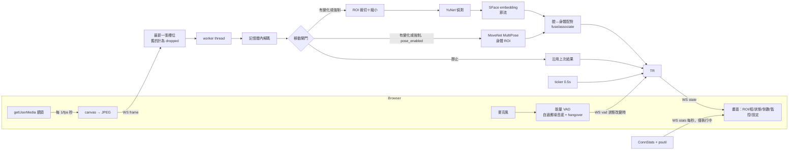
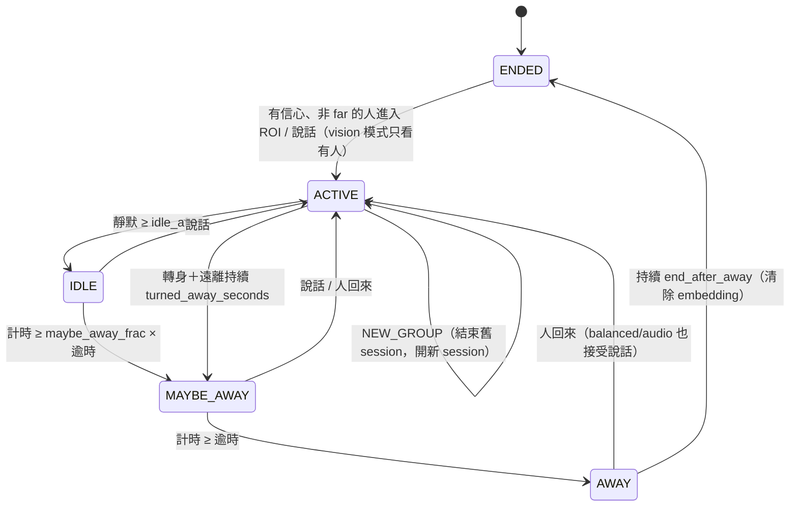

# 架構

## 元件

| 模組 | 說明 |
|---|---|
| `presence_demo/tracker.py` | `Config`、`PresenceTracker`：群組追蹤、遲滯、聲音／影像融合、狀態機。只依賴 numpy，時鐘可注入，完全可單元測試。 |
| `presence_demo/vision.py` | `Detector`／`Embedder` 介面；`YuNetDetector` + `SFaceEmbedder`（預設），`HaarDetector` + `HistEmbedder`（備援）；`VisionPipeline` 負責解碼、偵測、embedding 並計時。 |
| `presence_demo/body.py` | 純邏輯：`Body`、朝向判斷、臉和身體配對（`associate`）、頭部框、距離估計和校正。 |
| `presence_demo/optimizer.py` | `FrameProcessor`：移動偵測閘門、ROI 裁切＋縮小、embedding 節流；`recommend_fps()` 自適應 fps。全部在記憶體中處理。 |
| `presence_demo/stats.py` | `ConnStats`（每個連線的延遲 avg/p95、fps、丟棄張數、頻寬、RTT）和 `system_stats()`（psutil）。 |
| `presence_demo/server.py` | FastAPI：靜態頁、`/api/config`、`/ws`；權杖中介層；每個 WebSocket 一個 tracker。 |
| `presence_demo/static/index.html` | 單一檔案網頁（vanilla JS/CSS，不需建置）。 |

## 資料流

WebSocket 訊息：

| 方向 | type | 內容 |
|---|---|---|
| → | `start` / `stop` | 開始／停止（停止會重設 tracker、清除 embedding、忽略後續畫面） |
| → | `frame` | `data`（JPEG data URL）、`speech` |
| → | `vad` | `speech` |
| → | `config` | 部分設定；回覆 `config_ack` + `warnings` |
| → | `calibrate` | `meters`：用最近的人計算 `distance_calib`；回覆 `config_ack` |
| → | `ping` | `t`、上次 `rtt`；回覆 `pong` |
| ← | `state` | 狀態、計時、tracks、log、config、`running` |
| ← | `stats` | `system`、`conn`（latency/fps/frames/bandwidth/rtt）、`info` |

## 追蹤

1. 只保留中心點在 ROI 裡的偵測；有臉的偵測 conf < `min_conf`、只有身體的偵測 conf < `body_min_conf` 時算低信心。
2. 高信心偵測和既有 track 做 greedy 配對：分數 = cosine + 0.5·IoU。cosine ≥ `cos_match`，或 IoU ≥ `iou_match` 且 cosine ≥ `cos_weak`，就算同一個人。
3. 配對成功就更新 bbox、lastSeen，embedding 用 EMA 更新後再做 L2 正規化。沒配到的偵測建立新 track。
4. 連續在 ROI 裡 `join_seconds`（或依 `speech_join` 規則在說話時立即加入；vision 模式預設不會）就成為參與者；消失超過 `grace_seconds` 就移除。
5. 有人／ROI 空採遲滯判定：`present_frames`／`absent_frames`，低信心畫面不影響這兩個計數；連續低信心則切換成「不確定」。

## 姿勢、身體與距離

- **配對**：臉的中心點在身體的頭部區域內（和鼻子／眼睛關鍵點的距離在一個臉寬以內；沒有頭部關鍵點時，用身體框上方 40%）就配對成同一個人，貪婪地取最近的。沒配到臉的身體會建立「只有身體」的偵測，用關鍵點估計頭部框當作 track 框。
- **身分**：臉仍然用來計算 embedding。看不到臉時，用 track 框或身體框的 IoU 延續身分。
- **ROI 規則**：`either`（臉在臉部 ROI 或身體在身體 ROI）／`face`／`body`。
- **轉身提早預警**：所有可見參與者都是 `side`／`away`，而且身形約 2 秒內縮小超過 `recede_ratio`，並持續 `turned_away_seconds` 且沒有說話時，進入 MAYBE_AWAY（不會直接進入 AWAY）。
- **距離**：每個 track 用 EMA 平滑；超過 `leave_distance` 視為「遠離」，不算有人，也不會加入參與者。

## 狀態機

逾時和計時依 `priority_mode` 與影像狀態決定（詳見 CONFIGURATION.md）：

| 模式 | 有人 | ROI 空 | 不確定 |
|---|---|---|---|
| vision | 不因靜默離開（`present_max_silence` 上限，0＝關） | 空了 `empty_timeout` 就 AWAY，不管聲音 | `base_timeout`（靜默） |
| balanced | `present_timeout`（靜默） | `empty_timeout`，計時取 min(靜默, 空的秒數) | `base_timeout` |
| audio | 1.5 × `base_timeout` | 0.5 × `base_timeout` | `base_timeout` |

### NEW_GROUP

原本的參與者全部不在畫面上，而 ROI 裡有沒配對到的新 track 待滿 `join_seconds`，再持續 `new_group_seconds`，就觸發：記錄 `NEW_GROUP`、結束舊 session（清除 embedding）、用新的人開新 session。

## 隱私

- 影像只在記憶體解碼，處理完就丟棄。
- Embedding 只存在 `PresenceTracker.tracks`，ENDED、停止或斷線時清除。
- 停止時瀏覽器會關閉所有 media track 和 AudioContext。
