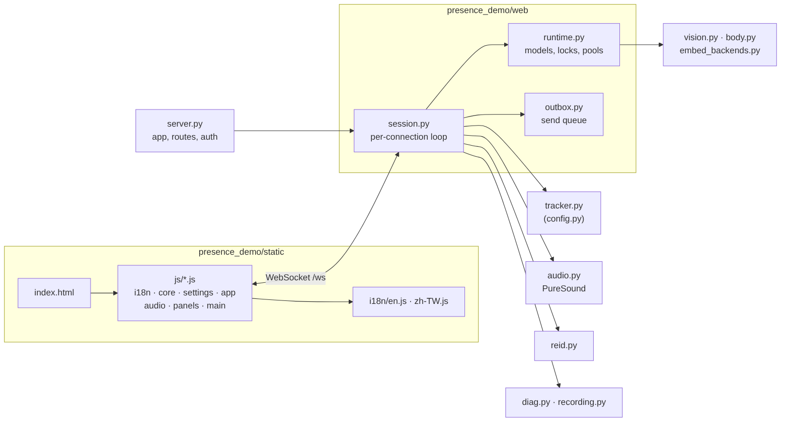
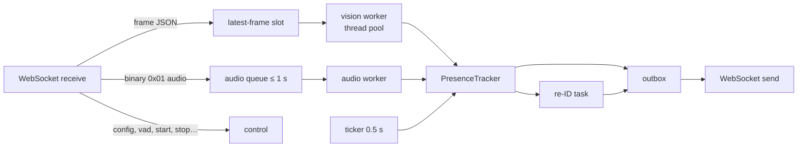

**English** · [繁體中文](zh-TW/architecture.md)

# Architecture

presence-demo is a Python package with a pure-logic core (no I/O, unit-testable with an injected clock) and a
FastAPI + WebSocket web demo around it. The browser captures camera and microphone and draws the UI; the server
does all the analysis in memory.



## Code layout

```
presence_demo/
  config.py          Config dataclass, RANGES (validation), State enum
  tracker.py         PresenceTracker: tracking, intent, presence, state machine (pure logic)
  kalman.py          constant-velocity Kalman filter, Hungarian algorithm
  presence_model.py  HMM log-odds helpers (Layer 2)
  intent.py          intent cues and smoothing (Layer 3)
  appearance.py      torso HSV histogram, Bhattacharyya similarity
  body.py            pose orientation, face↔body association, distance and calibration
  vision.py          YuNet / SFace / Haar fallback, MoveNet pose, in-memory decode
  embed_backends.py  SFace fp32 / int8 / TFLite (+ delegate) backends
  optimizer.py       motion gate, embedding throttle, ROI crop, adaptive fps
  audio.py           PureSound streaming glue, clean VAD, vision cross-check
  asr.py             AssemblyAI streaming client (optional)
  reid.py            cross-session re-ID manager and cloud backend (optional)
  diag.py            structured logging, redaction, event ring buffer, watchdog helpers
  stats.py           resource and latency statistics
  server.py          FastAPI app: routes, token middleware, static files, entry point
  web/
    runtime.py       process-wide models, locks, worker pools
    outbox.py        per-connection send queue with back-pressure
    session.py       the per-connection WebSocket loop
  static/
    index.html       markup only (text via data-i18n attributes)
    app.css          presence-specific layout on top of the vendored PureSound CSS
    js/              i18n · core · settings · app · audio · panels · main (classic scripts, load order matters)
    i18n/            en.js, zh-TW.js string tables
    vendor/puresound PureSound design system (unmodified)
scripts/             benchmark, evaluation, model export / fetch, figures, config docs
tests/               unit, scenario, WebSocket, privacy, UI and i18n tests
```

## One connection

Each browser tab opens one WebSocket (`/ws`). `web/session.py` runs for that connection:



- **Only the newest frame is processed.** If a frame arrives while the previous one is still running, the older
  waiting frame is dropped (and counted). The browser therefore never builds up lag.
- Detectors are shared by all connections behind a lock (`runtime.py`); each connection has its own tracker,
  audio state and re-ID store.
- A watchdog restarts a worker that makes no progress for 5 s while input keeps arriving, and logs a stack dump.
- Processing never waits for the network: the outbox is bounded, and when the browser or network is slow it drops new audio and superseded state messages instead of blocking the workers.

## WebSocket protocol

Browser → server (JSON unless noted):

| Message | Purpose |
|---|---|
| `frame` | `{data: base64 JPEG, speech, t}`, one camera frame |
| `vad` | Browser VAD changed (energy pipeline) |
| `config` | Settings changes; validated and clamped, warnings returned |
| `start` / `stop` / `reset` | Session control |
| `calibrate` | Distance calibration at a known distance |
| `record` | Ask for the recording stream (`0x03`) |
| `reid_wipe` | Clear stored reference faces |
| `client` | Browser diagnostics (visibility, reconnects…) |
| `ping` | Round-trip measurement (answered with `pong`) |
| binary `0x01` | Audio chunk: timestamp + 20 ms PCM16 at 16 kHz |

Server → browser:

| Message | Purpose |
|---|---|
| `state` | Tracks, state, reasons, `p_group`, suggested fps, timings |
| `audio` | Cross-check decision, VAD flags, gain, latency (every 100 ms) |
| `asr` | Transcript turns and status |
| `reid`, `handoff`, `reid_view`, `reid_view_clear` | Re-ID status, decision, optional thumbnails |
| `event`, `error` | Diagnostic events and error banners |
| binary `0x02` / `0x03` | Clean audio for monitoring / recording tracks |

## HTTP endpoints

| Endpoint | Purpose |
|---|---|
| `GET /` | The demo page |
| `GET /api/config` | Defaults and ranges |
| `GET /api/asr_status`, `POST /api/asr_key` | ASR key status / set (never returns the key) |
| `GET /api/reid_status`, `POST /api/reid_key`, `POST /api/reid_reset` | Re-ID key and references |
| `GET /debug/events` | Recent diagnostic events (see [Logging](logging.md)) |

With `PRESENCE_TOKEN` set, every route and the WebSocket need `?token=`. Only the vendored CSS, scripts and string
tables are public (they contain no data).

## Extending

- **Another detector or embedder**: implement `vision.Detector` / `vision.Embedder` and pass them to
  `VisionPipeline(detector=…, embedder=…)`.
- **Another re-ID provider**: implement `CloudReid.compare`.
- **A new parameter**: see [CONTRIBUTING](../CONTRIBUTING.md#adding-a-parameter).
