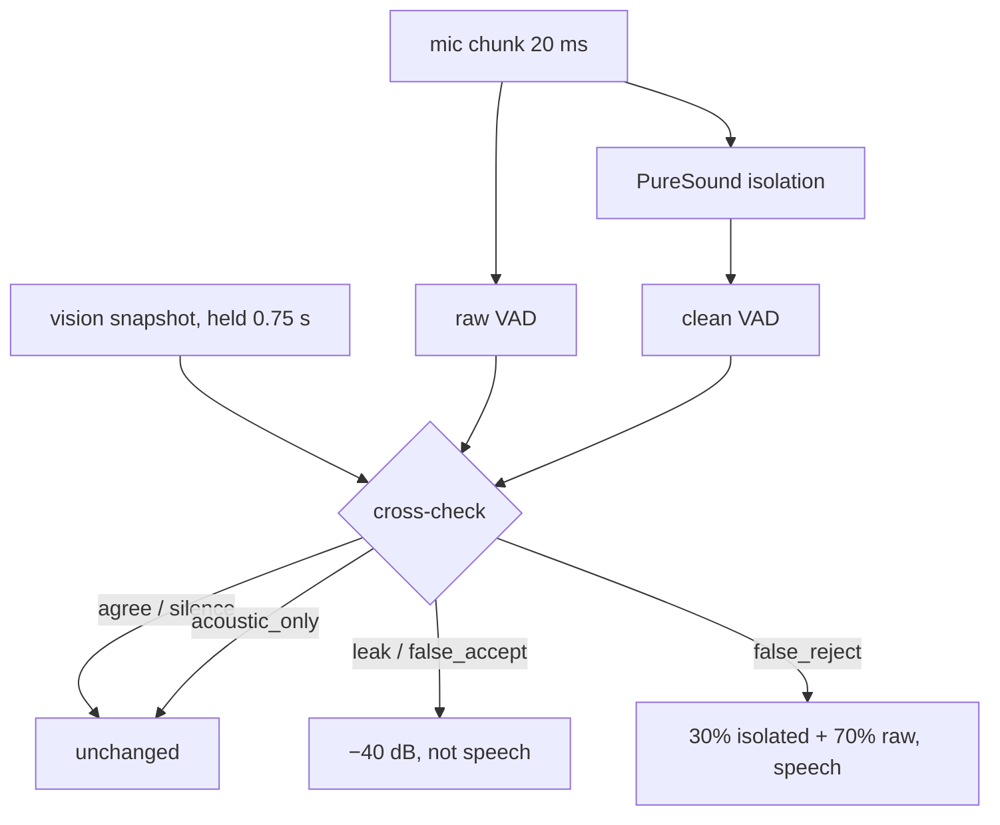
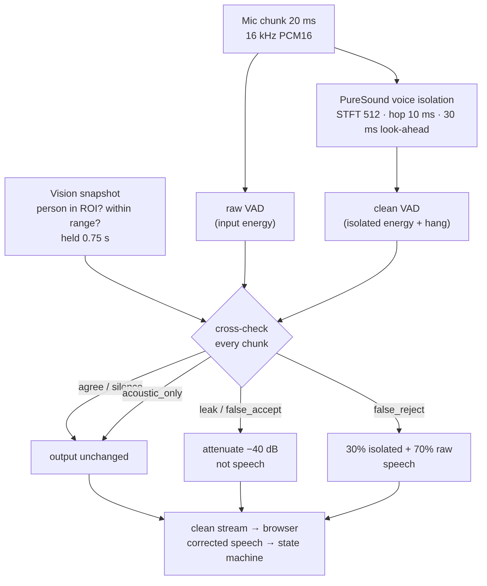
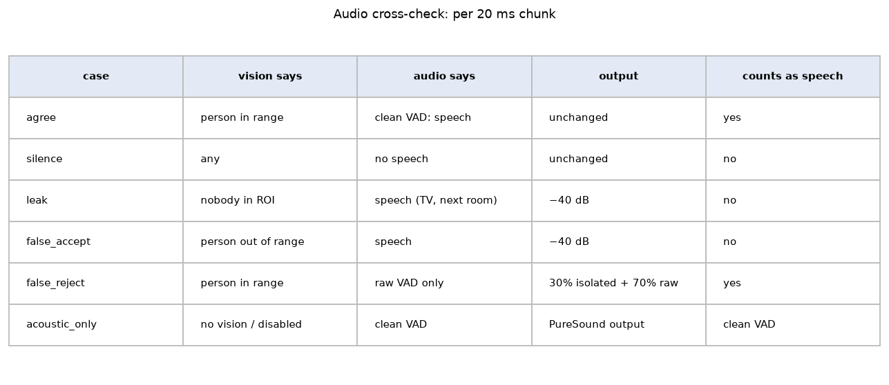

**English** · [繁體中文](zh-TW/audio.md)

# Audio: PureSound voice isolation + vision cross-check

Audio answers "is the user speaking?". Two pipelines are available (`audio_pipeline`):

| Pipeline | Where | How it decides "speech" |
|---|---|---|
| `energy_vad` (default) | Browser | Loudness above an adaptive noise floor (`vad_k`, `vad_min`, `vad_hang`). No install needed. |
| `puresound` | Server | Streaming voice isolation, a VAD on the isolated voice, then a per-chunk cross-check against vision. |

A loudness detector cannot tell the user from a TV, music, or someone talking across the room. The `puresound`
pipeline fixes this in two steps: an acoustic model keeps mostly the **near** voice, and the camera then vetoes
whatever the acoustic model gets wrong.





## Install

PureSound is an optional dependency (the standalone SDK from the public
[PureSound](https://github.com/mcw519/puresound) repository, Apache-2.0, pinned to a commit). It needs
Python ≥ 3.12.

```bash
uv sync --extra puresound
uv run python scripts/fetch_puresound_model.py --clone     # or --from /path/to/a/puresound/checkout
```

The model (`dpcrn_curriculum_v2`, 4.9 MB + manifest) is copied into `models/` only if its sha256 matches the
PureSound catalogue. Note that a plain `uv sync` removes the extra again. If the SDK or model is missing,
choosing `puresound` shows the reason in the audio panel and the state machine keeps using the browser VAD.

## Step 1: isolation (unchanged upstream code)

The browser captures the microphone with an `AudioWorklet`, resamples to 16 kHz mono and sends 20 ms chunks
(320 samples) over the WebSocket. The server runs PureSound's streaming processor exactly as upstream ships it:
STFT 512 / hop 10 ms, 30 ms look-ahead, output `0.9 × enhanced + 0.1 × aligned input`. Algorithmic latency is
52–62 ms. Outputs were verified to be bit-identical with the upstream runtime.

## Step 2: the clean VAD

The model has no VAD head, so the **clean VAD** is an energy detector on the *isolated* signal: 10 ms frames, an
adaptive noise floor (falls instantly, rises about 3 dB/s), speech when the level exceeds
`max(clean_vad_min_db, floor + clean_vad_margin_db)` for 60 ms, with `clean_vad_hang` (0.3 s) of hangover. The
same detector on the raw input gives the **raw VAD**, used only to detect missed speech.

## Step 3: the vision cross-check

Vision runs at 0.5–2 frames per second, audio at 50 chunks per second. To line them up, every chunk reads the
latest tracking snapshot, and the three facts "someone in the ROI", "someone within `near_range`" and "everyone is
beyond `near_range`" are each **held for `xcheck_hold`** (0.75 s). "Everyone beyond range" holds only if no near
person was seen during that time, which protects the first syllable of a near speaker.



| Clean VAD | Raw VAD | Vision | Decision | Output | Speech? |
|---|---|---|---|---|---|
| yes | – | nobody in the ROI | `leak` | attenuated to `xcheck_floor_db` (−40 dB) | no |
| yes | – | everyone beyond `near_range` | `false_accept` | attenuated | no |
| yes | – | someone within `near_range` | `agree` | unchanged | yes |
| no | yes | someone within `near_range` | `false_reject` | isolated share lowered to `xcheck_recover_mix` (0.3), rest is aligned raw input | yes |
| otherwise | | | `silence` | unchanged | no |
| any | | vision uncertain | `acoustic_only` | PureSound output as is | = clean VAD |

- **Vision uncertain** means: not started, no processed frame for `xcheck_stale` (2 s), only low-confidence
  detections, or the cross-check is off.
- **Distance** is used only when distance estimation is on. Without it, "near" means "in the ROI", and
  `false_accept` cannot happen. `xcheck_require_calib` also demands a distance calibration first.
- Gain changes ramp in 10 ms (`xcheck_attack`) and out in 50 ms (`xcheck_release`) to avoid clicks.

Example: the TV is on and nobody is in front of the device. PureSound passes some of the TV voice (it sounds
close enough). The clean VAD says "speech", vision says "nobody in the ROI" → `leak`: the chunk is attenuated by
40 dB and does not count as speech. The session does not start.

## Step 4: what the state machine sees

With the PureSound pipeline active, the **corrected** speech flag replaces the browser VAD:

- `onset_entry_only` (on): a session opens **only** on a corrected speech onset plus a visible, confident person
  within `leave_distance` seen in the last 1.5 s. Passers-by and voices alone never open a session.
- `onset_needs_vision` (on): returning from AWAY by speech also needs a visible person.
- `speech_join = auto` attributes clean speech to the only candidate, in every priority mode.
- If the audio stream stops for more than 1 s the browser VAD takes over again.

When the group changes (NEW_GROUP, a new session, or a different participant set) the isolation state is reset
(`iso_reset_on_change`), costing about 32 ms of output.

## Listening and recording

- **Monitor**: the audio panel can play the clean or raw stream back to you. Use headphones. Monitoring adds a
  small jitter buffer (≈ 80 ms) and your network round trip; decisions are made on the server and are not delayed
  by it.
- **Recording** (off by default, started by the user): three aligned 16 kHz WAV tracks (`raw`, `vi` = isolation
  output, `out` = final output after the cross-check) plus a JSON timeline of decisions and settings, zipped and
  downloaded **to the user's own computer**. Up to 10 minutes. The server writes nothing; video is never recorded.

## Performance

On an 8-core x86 test server, single-threaded ONNX Runtime:

| Item | Value |
|---|---|
| Isolation real-time factor | 0.22–0.27 (≈ 5 ms per 20 ms chunk) |
| Algorithmic latency | 52–62 ms |
| WebSocket + queue + compute, p50 / p95 | 6.0 / 7.8 ms |
| End-to-end estimate | ≈ 85–100 ms |
| Server CPU, 2 fps video + one face | video only 3.8% → video + audio 31.4% of one core |

Audio is much more expensive than vision. Measure on your target device before enabling it there.

## Known limits

- `near_range`, `xcheck_hold` and the clean-VAD levels are not yet tuned in many rooms; the −50 dBFS floor depends on
  microphone gain.
- The browser's own echo cancellation and noise suppression run before PureSound.
- A TV inside the ROI and closer than `near_range` cannot be told apart from a person.
- With several people near the device, the cross-check knows *someone near* is speaking, not *who*.
- Distance errors (for example a low camera angle) can cause wrong `false_accept`; calibrate distance first.

## License

PureSound code, SDK and weights are Apache-2.0. Its training data are not covered by that license; check before
commercial use. See [Licenses](licenses.md).
