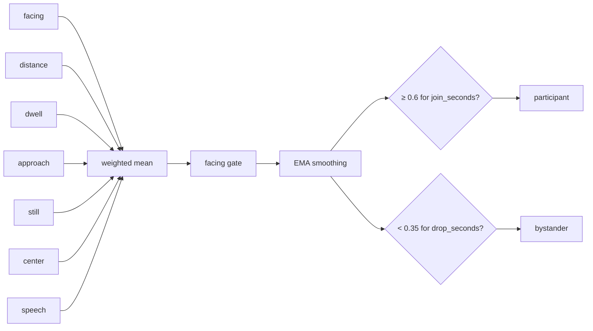
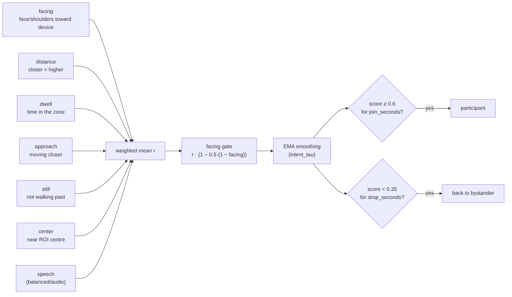
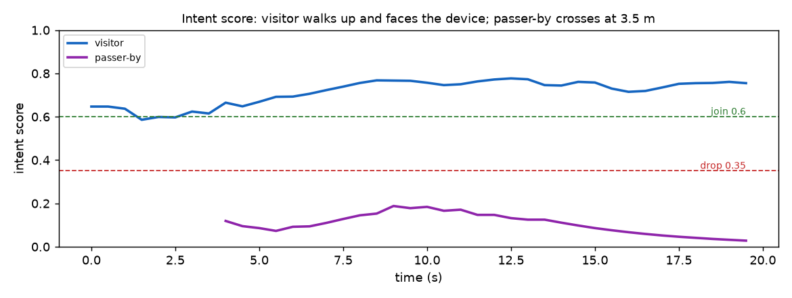

**English** · [繁體中文](zh-TW/intent.md)

# Intent: who wants to talk?

Not everyone in front of the camera is part of the conversation. A colleague waiting behind the user, someone
scrolling their phone nearby, a person walking past: if they count as participants, a finished conversation never
ends, and a passer-by can start one.

Each track therefore has a **role**: `participant` or `bystander`. Only participants keep a session alive.
`intent_model` chooses how the role is decided.

## `rules`: time in the ROI

Anyone whose face (or body, see `roi_rule`) stays inside the ROI for `join_seconds` (2 s), with a confident and
not-too-far detection, becomes a participant. Simple and predictable, but it cannot tell a viewer from a user.

## `score`: an engagement score from 0 to 1

### The cues

Each cue is a number between 0 (no sign of engagement) and 1 (strong sign):

| Cue | How it is measured | Weight (default) |
|---|---|---|
| **facing** | Face landmarks: nose centred between the eyes → 1, turned → 0. With pose, averaged with shoulder orientation; without a face, shoulders only. | `w_facing` 0.45 |
| **distance** | 1 inside the conversation zone (≤ `zone_max`), falling linearly to 0 at `leave_distance`. Skipped when distance is off. | `w_distance` 0.10 |
| **dwell** | Seconds in the ROI ÷ 4, capped at 1. | `w_dwell` 0.10 |
| **approach** | 0.5 + 4 × relative growth of the body per second, clipped to 0–1. Getting bigger = walking closer. | `w_approach` 0.05 |
| **still** | 1 − sideways speed ÷ 0.12 frame-widths per second. Walking past → 0. | `w_still` 0.15 |
| **center** | 1 − normalized distance from the ROI centre (vertical counts half). | `w_center` 0.15 |
| **speech** | 1 while someone speaks *and* it can reasonably be attributed to this person (the only candidate, or the only one facing the device). Otherwise left out, never a penalty. | 0.05 / 0.15 / 0.25 for vision / balanced / audio |

### From cues to a score

1. **Weighted mean** of the cues that have a value: `r = Σ wᵢ·cueᵢ / Σ wᵢ`. Missing cues are simply left out,
   and the weights renormalize.
2. **Facing gate**: `r_g = r × (1 − 0.5 × (1 − facing))`. Someone with their back to the device can stand in the
   middle for a long time and still not score high.
3. **Smoothing** over real time: `score ← score + (r_g − score) × (1 − e^(−dt / intent_tau))`, with
   `intent_tau` = 1 s. This is independent of the frame rate. When a track is not seen, its score sags slowly
   towards 0 (four times the time constant).

### Example

A visitor stands 1 m away in the middle of the ROI, facing the device, still, for 4 s. All cues are close to 1
except approach (0.5, no longer moving): `r ≈ (0.45 + 0.1 + 0.1 + 0.025 + 0.15 + 0.15) / 1.0 ≈ 0.97`. Facing is
≈ 1, so the gate barely changes it. A person crossing 3.5 m away, side-on: facing ≈ 0, still ≈ 0, distance 0 →
`r ≈ 0.2`, gated to ≈ 0.1.

The plot below is the real tracker on a synthetic scene: a visitor walking up and a passer-by crossing far away.

Typical scores with the default weights (medians over the evaluation scenes):

| Situation | Score | Result |
|---|---|---|
| Facing, slightly off-centre | ≈ 0.77 | joins |
| Standing at the edge watching, face turned, shoulders side-on | ≈ 0.42 | does not join |
| Close by, back turned, on the phone | ≈ 0.27 | does not join; a participant would be dropped after 8 s |
| Passer-by walking across side-on | ≈ 0.06 | does not join |

### What the score is used for

- **Join**: score ≥ `join_threshold` (0.6) for `join_seconds`, while detected and not too far.
- **Start a session**: from ENDED, someone must reach the join condition. In balanced / audio mode speech can
  still start a session.
- **Drop**: a participant whose score stays below `drop_threshold` (0.35) for `drop_seconds` (8 s) while visible
  becomes a bystander. **The last participant is never dropped**: whether they left is the presence layer's job.
- **Presence (HMM)**: the group probability only looks at participants, so bystanders cannot keep a session
  alive. `intent_weighted_presence` additionally scales each participant's evidence by `min(1, score / 0.6)`.
- **NEW_GROUP**: newcomers must also reach the join condition.

## Results on synthetic scenes

Compared with the three `rules` combinations (20 seeds per scene):

- **False joins** (passer-by, viewer, phone user): from 60 to **0**.
- **Participant leaves while a bystander stays**: the rules versions never ended the session (20 of 20); with
  `score` it reached AWAY after **5.0 s**.
- **Cost**: a newcomer who walks up and talks joins after about 3.0 s instead of 2.0 s (they need to approach, face
  the device and let the score settle).
- No regressions in the other scenes.

**Limits.** Someone standing right in the middle and staring at the device without wanting to talk will still
become a participant: vision alone cannot read minds. The bystander poses in the evaluation are scripted; check
the real distribution by watching the intent bars in the UI (hover a bar to see every cue).

## Tuning tips

- Joining feels slow → lower `join_threshold` (for example 0.55) or `intent_tau`.
- Bystanders still join → raise `w_facing` or `join_threshold`.
- People who talk while looking sideways get dropped → raise `drop_seconds` or lower `drop_threshold`.
