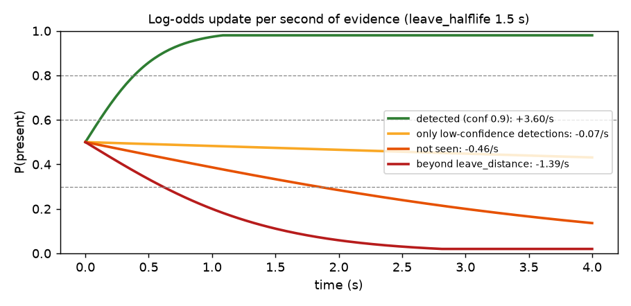
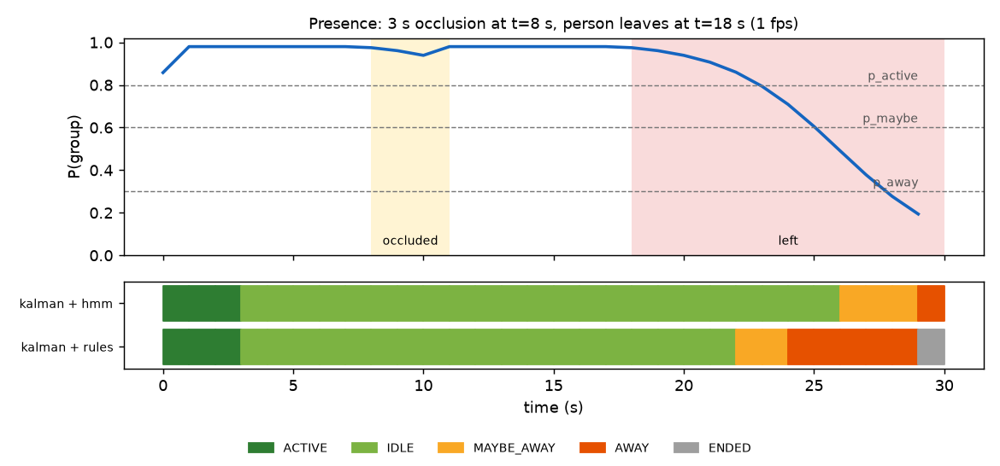

**English** · [繁體中文](zh-TW/presence.md)

# Presence: is the group still here?

Detections flicker. A face is missed in a dark frame, someone turns their head, a person walks in front of the
camera. The presence layer turns this noisy, frame-by-frame evidence into one stable signal for the state machine.
Choose it with `presence_model`.

## `rules`: counters and timeouts

- The group is **present** after `present_frames` (2) consecutive frames with a confident participant in the ROI.
- It is **empty** after `absent_frames` (3) consecutive frames without one.
- Frames with only low-confidence detections are **uncertain**: vision abstains and audio decides.

The state machine then applies a silence timeout that depends on this path and on `priority_mode`
(see [State machine](state-machine.md#timeouts-in-rules-mode)). Easy to reason about, but every missed frame counts
fully, so a flickering detector can cause false MAYBE_AWAY or even AWAY.

## `hmm`: a probability per person

The idea: keep, for each person, a belief "how likely is it that this person is still here?" and update it with
every frame. Good evidence pushes it up quickly; missing evidence lets it drain slowly; weak evidence barely moves
it. Decisions use thresholds with hysteresis, so the state does not flip back and forth.

### Log-odds, in two lines

Instead of the probability *P* the model stores the **log-odds** `L = ln(P / (1 − P))`. Adding `ln 2 ≈ 0.69` to
*L* doubles the odds of "present". This makes the update a simple addition:

```
L ← clip(L + rate × dt, −3.9, +3.9)
```

`dt` is the real time since the previous frame, so the result is the same at 0.5 fps or 2 fps. The clip keeps *P*
between 0.02 and 0.98, so a person who stood still for an hour does not become "impossible to lose".

This is a two-state hidden Markov model (present / gone) written in continuous time. The decay is the transition
("people may leave"), the evidence is the likelihood ratio of the observation.

### Evidence rates (per second)

With `λ = ln 2 / leave_halflife` (1.5 s → λ ≈ 0.46 / s):

| What this frame shows for the track | Rate | Meaning |
|---|---|---|
| Detected (face or body) with confidence *c* | `+detect_gain × c` (4 × 0.9 = +3.6) | Seen: belief rises fast |
| Kalman prediction only (coasting) | `−λ × (1 − vis_conf)` | Just vanished: almost no change; later close to "not seen" |
| Not matched, but the frame has low-confidence detections | `−λ × lowconf_factor` (0.15) | Nearly neutral: bad light should not mean "gone" |
| Not seen at all | `−λ` | Odds halve every `leave_halflife` |
| Turned away **and** moving away | `−λ` (even if detected) | Pushes towards "left" |
| Beyond `leave_distance` | `−3λ` | Strong push towards "left" |

A new track starts at P = 0.5 plus half a second of evidence.



Read the plot like this: with nothing seen, a confident person (P = 0.98) needs about 10 s to fall below 0.3; only
low-confidence detections slow that down about seven-fold; standing beyond `leave_distance` speeds it up three-fold.

### Group probability

1. **Vision part** `P_vis`: the highest P among participants (or among all tracks when there are none yet). A
   steady newcomer who already meets the join condition is included too, so that the state does not drop to AWAY
   just before NEW_GROUP takes over.
2. **Audio part** `A`: a weak, global offset added to the group's log-odds. Sound is never assigned to a person.
   - while speaking: `A = w_speech × 5`
   - while silent: `A = −w_silence × 6 × min(1, silence / base_timeout)`

   | `priority_mode` | w_speech | w_silence | Effect |
   |---|---|---|---|
   | vision | 0.05 | 0 | Audio barely matters; a quiet person in view is never "gone" |
   | balanced | 0.8 | 0.8 | Speech holds a session; long silence with people present slowly ends it |
   | audio | 1.0 | 1.0 | Mostly speech-driven |

3. `P_group = sigmoid(logit(P_vis) + A)`.

### States, with hysteresis

| Condition | Result |
|---|---|
| `P_group < p_away` (0.3) for `away_hold_seconds` (1 s) | **AWAY** |
| `P_group < p_maybe` (0.6), or already MAYBE_AWAY and `P_group < p_active` (0.8) | **MAYBE_AWAY** |
| otherwise | **ACTIVE** (recent speech) or **IDLE** (quiet for `idle_after`) |
| In AWAY and `P ≥ p_active` | back to **ACTIVE**. In vision mode only `P_vis` counts, so a sound cannot "bring someone back" |
| AWAY for `end_after_away` | **ENDED** (same as rules) |

The gap between 0.6 (enter MAYBE_AWAY) and 0.8 (leave it) is the hysteresis: a probability hovering around 0.6
does not make the state flicker.

## Comparing the two

Real tracker, synthetic scene at 1 fps: a 3 s occlusion at t = 8 s, then the person leaves at t = 18 s.



- During the occlusion the HMM barely moves (0.98 → 0.94). Rules mode survives this one too at these defaults.
- After the real departure, rules reaches MAYBE_AWAY after about 4 s, the HMM after about 8 s. That is the price
  of being robust: halve `leave_halflife` and the HMM is about twice as fast.

From `scripts/eval_tracking.py` (20 seeds per scene, summed; measured with the earlier defaults
`leave_halflife` 0.6 s and `min_conf` 0.6):

| Scene | legacy+rules | kalman+rules | kalman+hmm |
|---|---|---|---|
| Low-confidence flicker (40% of frames at conf 0.4): false AWAY | 27 | 27 | **0** |
| Same: false MAYBE_AWAY | 13 | 13 | **5** |
| Same: state changes per minute | 7.5 | 7.5 | **2.2** |
| Occlusions 1–3 s at 1 fps: false MAYBE_AWAY | 20 | 20 | **0** |
| Slow departure (turns, shrinks over 6 s): time to AWAY | 11.0 s | 12.0 s | **7.9 s** |
| New person steps into the same spot 2 s after the old one left: false MAYBE_AWAY | 0 | 0 | 20 |
| Total false MAYBE_AWAY / AWAY, all scenes | 53 / 27 | 53 / 27 | **25 / 0** |

The one scene where the HMM looks worse is arguably correct: the original user really did leave, and the HMM
says so briefly before NEW_GROUP starts a new session.

## Which one to use?

- Start with `kalman` + `hmm` (+ `score` intent): the *Recommended* preset. Watch the **presence probability**
  chart in the UI.
- Too slow to notice departures → lower `leave_halflife`. Too many false MAYBE_AWAY → raise it.
- Lighting is poor and detections are weak → keep `lowconf_factor` small so weak frames stay neutral.
