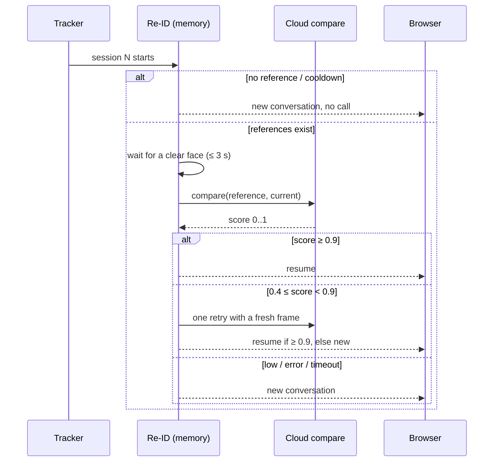
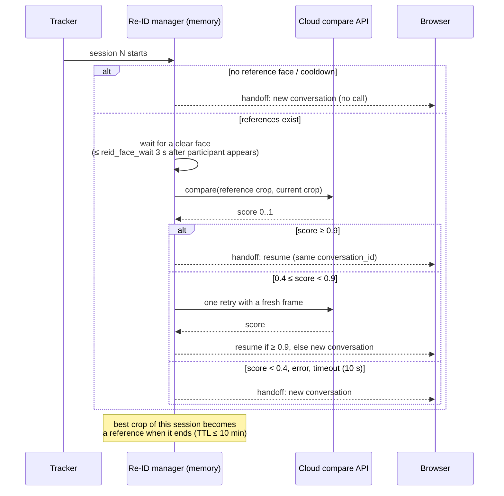

**English** · [繁體中文](zh-TW/reid.md)

# Re-ID: is this the same user as last time? (optional)

> **Off by default.** When enabled, face crops **leave the device** and are sent to a third-party cloud service,
> and the server keeps the last users' face crops **in memory** for a short time. Read the privacy section first.

## What it is for

When the presence tracker opens a **new session**, a downstream dialogue system often wants to know whether the
previous user just came back (continue the conversation) or someone new arrived (start over). Re-ID makes that
guess and outputs a `conversation_id`:

- **same person** → the previous `conversation_id` is reused (`decision: resume`);
- **different, unsure, or any failure** → a new `conversation_id` (`decision: new`).

presence-demo has no conversation memory itself. "Resume" only means "same id"; the downstream system decides what
to do with it. The service is never called during a session, and never when there is no stored reference face.

## How a decision is made





1. **Wait for a usable face.** The first participant must show a clear face (frontal or slight side view, width
   ≥ `reid_min_face`, 6% of the frame). If none appears within `reid_face_wait` (3 s) after the participant
   appears, the result is `new` (`no_face_timeout`). The whole wait is capped by `reid_decision_timeout` (10 s);
   the clock pauses while the state is MAYBE_AWAY or AWAY.
2. **Compare** with the stored references, newest first, at most `reid_max_refs` (3).
3. **Decide**:
   - score ≥ `reid_threshold` (0.9) → `resume` (`match`);
   - `reid_uncertain_low` (0.4) ≤ score < 0.9 → one more comparison with a fresh frame, then `resume` or `new`
     (`uncertain`);
   - below 0.4 → `new` (`below_threshold`);
   - timeout, HTTP error, no key, rate cap, open circuit breaker → `new` (`error`, `no_key`, `cap`, `breaker`).
4. During the session the server keeps the **best** face crop of this user. When the session ends it becomes a
   reference for next time.

The decision runs in the background. It never delays the session start, video or audio. Rapid re-opens within
`reid_cooldown` (5 s) are `new` without a call. Calls are capped per hour (`reid_cap_per_hour`) and per connection
(`reid_cap_total`).

Why 0.9? On 100 random LFW pairs the bundled service reached AUC 0.992. At 0.9 there were **no false accepts**
and 14% false rejects. A false "resume" (mixing two users' conversations) is worse than a false "new", so the
threshold is strict.

## Output

```json
{"type": "handoff", "session": 12, "conversation_id": "3f…", "decision": "resume",
 "resumed_from_session": 11, "score": 0.94, "reason": "match", "calls": 3}
```

`conversation_id` is a random UUID with no link to identity. A once-per-second `{"type": "reid"}` status (phase,
number of references, time left, calls, tokens, cost estimate) contains no images.

## Privacy: the in-memory exception

The server's rule is that it never stores images. Re-ID needs to remember a face, so there is one written
exception:

| Item | Rule |
|---|---|
| What | One face crop per user (320 × 320 JPEG). Never whole frames. |
| Where | Server process memory, bound to that WebSocket connection. Never disk, temp files, logs or `/debug`. |
| How long | `reid_ttl`, default and maximum **600 s (10 minutes)**; at most `reid_max_refs` users. |
| Cleared on | Expiry, turning the feature off, *Clear references* in Settings, `reset`, `POST /api/reid_reset`, disconnect, shutdown. |
| Sent to | The selected cloud service, two crops per comparison. |
| Enabled by | `reid_enabled` **and** `reid_consent` (both off by default). |
| Display thumbnails | With `reid_show_crops` (*Show comparison photos*), each decision sends 112 × 112 thumbnails of the compared faces to **this browser only** for the comparison card (last 4, browser memory). They are never written to disk, logs, diagnostics, `/debug` or recordings, and are wiped together with the references. |

Faces are biometric data and are specially regulated in many places (for example GDPR art. 9). If you deploy this,
inform people on site, obtain consent, check the cloud provider's retention policy and consider a shorter
`reid_ttl`.

## Backends

The interface is `presence_demo.reid.CloudReid.compare(reference_jpeg, query_jpeg) -> (score, meta)`; adding a
provider means implementing that method. The bundled backend calls the Typesafe "Jev" visual comparison API.
The API key comes from the environment variable `TYPESAFE_API_KEY` or the password field in Settings
(`POST /api/reid_key`); it is kept in memory only and never logged or returned. `REID_JEV_URL` overrides the
endpoint for tests or a proxy.
