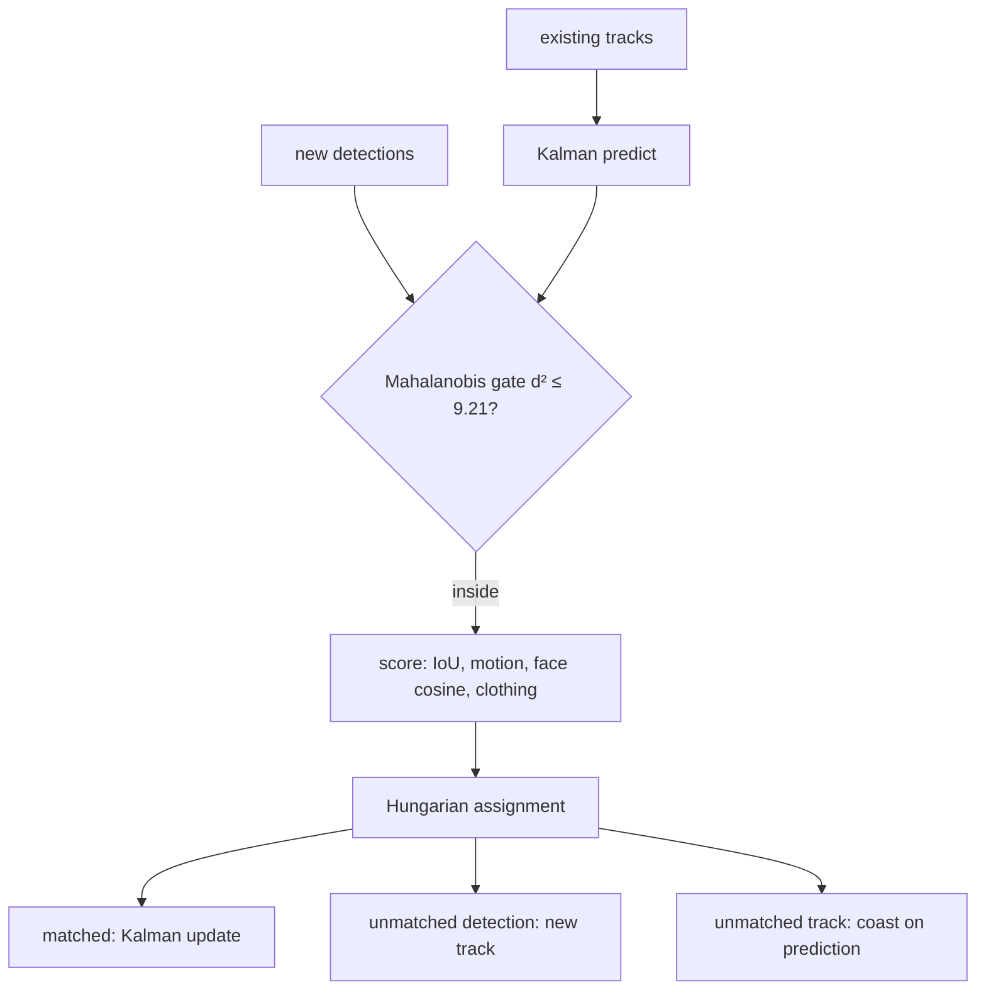
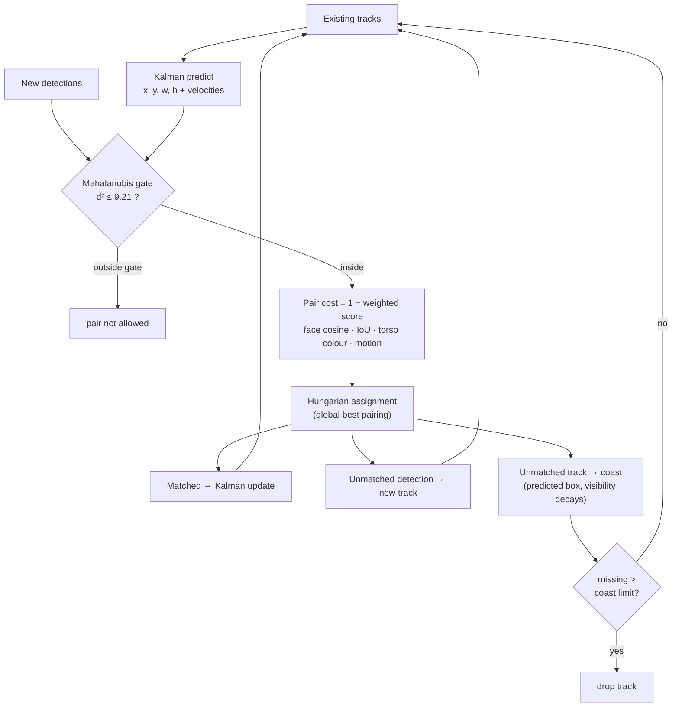

**English** · [繁體中文](zh-TW/tracking.md)

# Tracking

Detection tells us *where faces are in this frame*. Tracking answers *which person is which over time*. Without
it, every frame would be a group of strangers and nothing could be timed ("has she been here for 2 seconds?").

Each person gets a **track** with an id, a box, a face embedding template (updated slowly, `embed_ema` 0.15), and
timers. Tracks that are not seen are kept for `grace_seconds` (15 s) so that a brief occlusion does not create a
new person. Choose the algorithm with `tracker_mode`.

## `legacy`: greedy matching

For every (detection, track) pair:

1. compute face cosine `cos` and box overlap `IoU` (body boxes are used when a face is missing);
2. accept the pair if `cos ≥ cos_match`, or `IoU ≥ iou_match` with `cos ≥ cos_weak`, or `IoU ≥ iou_match` when one
   side has no face;
3. sort accepted pairs by `cos + 0.5 · IoU` and assign greedily, best first.

It is simple and works well when faces are visible. Its weak spot: when two people without visible faces swap
places, overlap alone cannot tell them apart and the ids swap.

## `kalman`: predict, gate, match globally, coast

**1. Predict.** Each track carries a constant-velocity Kalman filter. The state has eight numbers: the box centre,
width and height `(cx, cy, w, h)` and their velocities. The real time between frames is used, so 0.5 fps and 2 fps
both predict correctly. Intuition: "she was walking left at 10% of the frame per second, so one second later she
should be 10% further left."

**2. Gate.** The prediction comes with an uncertainty. The **Mahalanobis distance** measures how surprising a
detection is given that uncertainty. A pair is ruled out when `d² > gate_mahalanobis` (9.21, the 99% point of a
chi-square with 2 degrees of freedom) *and* the boxes do not overlap *and* the faces do not strongly match. Pairs
are also ruled out when faces say "different" (`cos < cos_weak`) or, without faces, when clothing says "different"
(colour similarity < `appearance_min_sim` 0.6).

**3. Score.** Every remaining pair gets a weighted average of the cues that are available:

| Cue | Value | Weight |
|---|---|---|
| Box overlap | IoU of predicted and detected box (or body boxes) | 1 |
| Motion agreement | `exp(−d² / gate)` | 1 |
| Face similarity | `cos / cos_match`, capped at 1 | 2 |
| Clothing colour | `(similarity − 0.5) / 0.5`, clipped to 0–1 | 1.5 |

Only pairs scoring ≥ 0.3 are allowed. The cost is `1 − score`.

**4. Match globally.** The **Hungarian algorithm** picks the set of pairs with the lowest total cost. Greedy
matching can make one early "good enough" choice that forces a bad one later; the Hungarian algorithm cannot.
(The implementation is self-contained, no SciPy, and is tested against brute force.)

**5. Coast.** A track that was not matched keeps moving along its prediction for `coast_seconds` (2 s). Its
visibility fades: `vis_conf = 1 − missing / coast_seconds`. While `vis_conf ≥ coast_present_conf` (0.4, about
the first 1.2 s) the track still counts as present. Coasting tracks never earn join time and never count as
newcomers for NEW_GROUP.

Each track in the state output has `visible_kind` (`detected` / `predicted` / `none`), `vis_conf` and `velocity`.

## Results on synthetic scenes

`scripts/eval_tracking.py` runs scripted scenes (20 random seeds each) through the real tracker. Summed over seeds:

| Scene | Mode | ID swaps | Track breaks | False MAYBE_AWAY | Time to AWAY |
|---|---|---|---|---|---|
| Occlusions 1–3 s, 2 fps | legacy | 0 | 0 | 20 | — |
| | kalman | 0 | 0 | **0** | — |
| Two people swap places, faces hidden | legacy | 38 | 38 | 0 | — |
| | kalman | **0** | **0** | 0 | — |
| Crossing, side views, variable fps, new person | both | 0 | 0 | 0 | — |
| Person leaves | legacy | 0 | 0 | 0 | 5.0 s |
| | kalman | 0 | 0 | 0 | 6.0 s |

What it means:

- Kalman removes identity swaps when faces are hidden, and rides through short occlusions.
- The cost is about **1 s slower** "left" detection, because the coasting track still counts as present. Lower
  `coast_seconds` or raise `coast_present_conf` if that matters more to you.
- The extra compute (a small histogram per person and the Hungarian step for ≤ 6 people) is under 0.5 ms.

**Limits.** These are synthetic scenes: noise levels and clothing are assumptions. Two people with similar
clothes and no visible faces are still hard. Validate on your own recordings before relying on the numbers.
