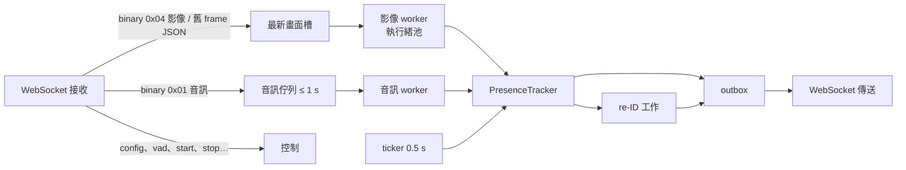

[English](../architecture.md) · **繁體中文**

# 架構

presence-demo 是一個 Python 套件：核心是純邏輯（沒有 I/O，可以注入時鐘做單元測試），外面包一層 FastAPI + WebSocket 網頁 demo。
瀏覽器負責擷取鏡頭和麥克風、繪製介面；所有分析都在伺服器記憶體中完成。


## 程式結構

```
presence_demo/
  config.py          Config 資料類別、RANGES（驗證範圍）、State 列舉
  tracker.py         PresenceTracker：追蹤、意圖、在場、狀態機（純邏輯）
  kalman.py          等速 Kalman 濾波、匈牙利演算法
  presence_model.py  HMM 對數勝算（Layer 2）
  intent.py          意圖線索與平滑（Layer 3）
  appearance.py      軀幹 HSV 直方圖、Bhattacharyya 相似度
  body.py            姿勢朝向、臉與身體配對、距離與校正
  vision.py          YuNet / SFace / Haar 備援、MoveNet 姿勢、記憶體內解碼
  embed_backends.py  SFace fp32 / int8 / TFLite（+ delegate）後端
  optimizer.py       移動閘門、embedding 節流、ROI 裁切、自適應 fps
  audio.py           PureSound 串流銜接、乾淨 VAD、影像交叉確認
  asr.py             AssemblyAI 串流用戶端（選用）
  reid.py            跨 session re-ID 管理與雲端後端（選用）
  acceptance.py      統一的離線 PoC 驗收 runner 與報告格式
  acceptance_cases.py 合成狀態機情境與 re-ID mock 案例
  acceptance_pipeline.py 隔離的本機模型 WebSocket 重播與長時間量測
  acceptance_browser.py 隔離的 headless Chrome 瀏覽器驗收 adapter
  acceptance_browser_reid.py 隔離的 Chrome 到 server re-ID／handoff 驗收 adapter
  diag.py            結構化日誌、遮蔽、事件環形緩衝、watchdog 工具
  stats.py           資源與延遲統計
  server.py          FastAPI 應用：路由、權杖中介層、靜態檔、進入點
  web/
    runtime.py       程序共用的模型、鎖、執行緒池
    outbox.py        每個連線的傳送佇列（含背壓）
    session.py       每個連線的 WebSocket 主迴圈
    continuity.py    頁面範圍的重連租約與在場觀察時鐘
  static/
    index.html       只有版面（文字用 data-i18n 屬性）
    app.css          在 PureSound CSS 之上的 presence 專用版面
    js/              i18n · core · settings · app · audio · panels · main（一般 script，載入順序有意義）
    i18n/            en.js、zh-TW.js 字串表
    vendor/puresound PureSound 設計系統（未修改）
scripts/             基準測試、評估、模型匯出／下載、圖片、設定文件
  run_acceptance.py  統一驗收 runner CLI
  acceptance_browser_fixture.js 共用的合成媒體與 app 流程瀏覽器 fixture
  acceptance_browser_reid_fixture.js 隔離 browser 驗收的 re-ID 控制項
tests/               單元、情境、WebSocket、隱私、介面和 i18n 測試
```

## 一個連線

每個瀏覽器分頁開一個 WebSocket（`/ws`），由 `web/session.py` 處理：



- **只處理最新的畫面。** 前一張還在處理時又來了新畫面，較舊的等待畫面會被丟掉（並計數），所以瀏覽器端不會累積延遲。
- 偵測器由所有連線共用，用鎖保護（`runtime.py`）；每個連線有自己的追蹤器、音訊狀態和 re-ID 參考臉。
- 輸入持續進來但 worker 5 秒沒有進展時，watchdog 會重啟它並記錄 stack dump。
- 處理從不等待網路：outbox 有上限，瀏覽器或網路慢時，會丟掉新的音訊和會被取代的狀態訊息，而不是卡住 worker。
- 同一載入頁面會用隨機 page capability 重新取得記憶體中的參考臉。每條傳輸租約都有 generation；已被取代的連線無法更新目前頁面狀態。傳輸中斷會暫停在場觀察時鐘並標示感測中斷，不會假造正常的 `ENDED`。時鐘停在最後完成畫面後 3 秒，因此主機睡眠後 ticker 延遲醒來也不會把睡眠時間算成缺席。
- FastAPI lifespan 擁有每秒執行一次的頁面／參考臉到期清理工作，所以最後一條 WebSocket 關閉後仍會清理。中斷頁面 600 秒後到期，server 關閉時清除其餘頁面 store。已正常 `ENDED` 的 conversation 之後即使續接再中斷，也沿用原本 600 秒期限；從未正常結束的 conversation 則從第一次中斷起取得固定 600 秒租約。

## PoC 驗收 runner

[`scripts/run_acceptance.py`](../../scripts/run_acceptance.py) 提供 `functional`、`pipeline`、`browser`、`browser-reid`、`soak` 和 `all` 套件；`all` 依此順序執行。它會輸出 JSON 結果及 Markdown 摘要，包含逐案例狀態、門檻、允許清單中的環境資訊和限制。功能情境使用虛擬時鐘與身分 mock；pipeline／soak 會啟動隔離 server，使用本機模型透過 loopback 重播合成媒體。`browser` 和 `browser-reid` adapter 共用隔離 headless Chrome、暫存 profile、loopback server 與合成媒體，經由 app media 路徑提供 canvas 影像與音訊，不呼叫原生 `getUserMedia`，並走過 production 擷取計時器、AudioWorklet、binary JPEG／PCM 和 WebSocket 生命週期。transport fixture 使用 `rules` tracker、`vision`、full-face ROI、`leave_distance=10m`、2 fps，並停用 pose；它不使用 functional 套件的 HMM／score `PROFILE_CONFIG`。影像中斷是暫停並恢復 production capture timer 超過 3 秒，不是真實 track 故障或拔除硬體。案例包含啟動、恢復後不誤進入 `ENDED` 且維持同一 session、重連後建立新 session並保留 page capability、stop 清理和 pagehide 清理。`browser` 在 re-ID 關閉時驗證傳輸生命週期。`browser-reid` 透過 production consent 設定、production crop 和 `CrossSessionReid` 檢查 provisional conversation 到明確 handoff；只有隔離 child server 注入本機 mock `CloudReid`。它也檢查等待中撤回同意、拒絕延遲結果、持續處理 JPEG／PCM 和清理。consent 設定只是測試工具，不代表真人同意。Crop bytes 與 page capability 留在記憶體；報告只記錄布林與數值，不含識別碼或影像資料。兩個套件都不連 Jev 或雲端 ASR、不驗生物特徵準確度，也不作 RTF 門檻驗收。`--browser-seconds` 設定穩定串流時間；生命週期檢查會額外花時間。Chrome 在啟動前缺失會標示 `not_run`；開始執行後失敗則標示 `failed`。真實裝置與取得同意的 Jev 品質案例仍是 `pending_real`，TV 視覺語意分類仍是 `not_run`。只有足夠長的真實時間 soak 才能驗收 30 分鐘效能與 RSS 門檻。完整規格見 [PoC 驗收契約](acceptance.md)。

## WebSocket 協定

瀏覽器 → 伺服器（除非註明，都是 JSON）：

WebSocket handshake 會提供 `presence-v1` 和頁面專屬的 `page-<32 個小寫十六進位字元>` subprotocol。頁面 capability 不會放進 URL；診斷遮蔽器會遮住 protocol 除錯標頭中的 capability。`pagehide` 會另外透過 page-close beacon 的 JSON body 傳送它。

| 訊息 | 用途 |
|---|---|
| `frame` | 舊格式：`{data: base64 JPEG, speech, t}`，一張鏡頭畫面 |
| `vad` | 瀏覽器 VAD 改變（energy 管線） |
| `config` | 設定變更；驗證並限制範圍後回傳警告 |
| `start` / `stop` / `reset` | session 控制 |
| `calibrate` | 在已知距離做距離校正 |
| `record` | 要求錄音串流（`0x03`） |
| `reid_wipe` | 清除參考臉 |
| `client` | 瀏覽器診斷（可見性、重新連線…） |
| `ping` | 量測往返時間（回 `pong`） |
| binary `0x01` | 音訊區塊：時間戳 + 20 ms、16 kHz PCM16 |
| binary `0x04` | 影像：1-byte tag、float64 little-endian 用戶端時間戳（ms）、1-byte speech（0/1），再接 JPEG bytes；header 共 10 bytes。 |

伺服器 → 瀏覽器：

| 訊息 | 用途 |
|---|---|
| `state` | track、狀態、原因、`p_group`、建議 fps、耗時 |
| `audio` | 交叉確認判斷、VAD 旗標、增益、延遲（每 100 ms） |
| `asr` | 逐字稿和狀態 |
| `reid`、`handoff`、`reid_view`、`reid_view_clear` | re-ID 狀態、判斷、選用縮圖 |
| `event`、`error` | 診斷事件和錯誤橫幅 |
| binary `0x02` / `0x03` | 監聽用的乾淨音軌／錄音音軌 |

## HTTP 端點

| 端點 | 用途 |
|---|---|
| `GET /` | demo 頁面 |
| `GET /api/config` | 預設值和範圍 |
| `GET /api/asr_status`、`POST /api/asr_key` | ASR key 狀態／設定（從不回傳 key） |
| `GET /api/reid_status`、`POST /api/reid_key`、`POST /api/reid_reset` | re-ID key 和參考臉 |
| `GET /debug/events` | 最近的診斷事件（見[日誌](logging.md)） |

設定 `PRESENCE_TOKEN` 後，所有路由和 WebSocket 都需要 `?token=`。只有 vendored CSS、script 和字串表是公開的（不含任何資料）。

## 擴充

- **換偵測器或 embedder**：實作 `vision.Detector` / `vision.Embedder`，傳給 `VisionPipeline(detector=…, embedder=…)`。
- **換 re-ID 服務**：實作 `CloudReid.compare`。
- **新增參數**：見 [CONTRIBUTING](../../CONTRIBUTING.md#adding-a-parameter)。
