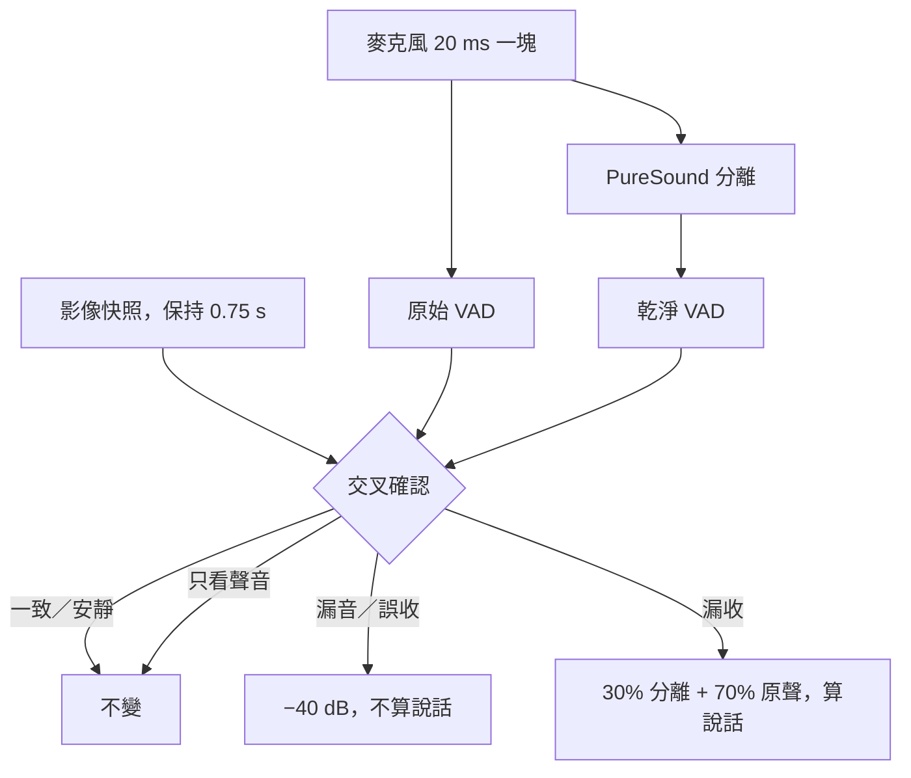
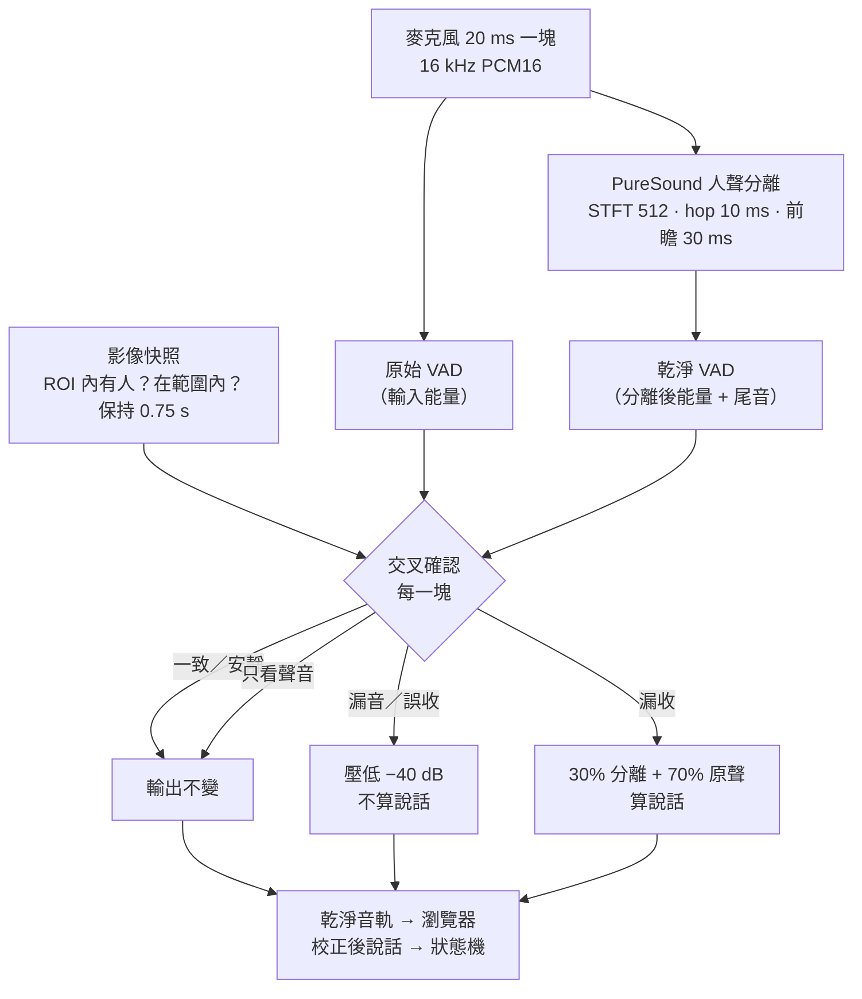
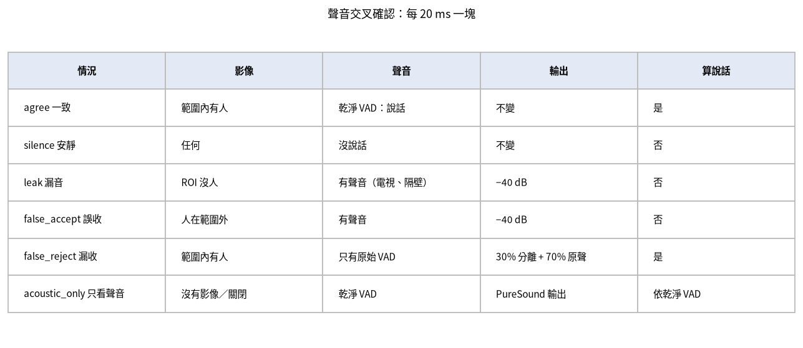

[English](../audio.md) · **繁體中文**

# 音訊：PureSound 人聲分離 + 影像交叉確認

音訊回答「使用者在說話嗎？」。有兩種管線（`audio_pipeline`）：

| 管線 | 在哪裡 | 怎麼判斷「說話」 |
|---|---|---|
| `energy_vad`（預設） | 瀏覽器 | 音量超過自適應噪音底（`vad_k`、`vad_min`、`vad_hang`）。不需要安裝。 |
| `puresound` | 伺服器 | 串流人聲分離，對分離後的聲音做 VAD，再逐塊用影像交叉確認。 |

音量偵測分不出使用者、電視、音樂或房間另一頭的人。`puresound` 管線用兩步解決：聲學模型主要保留**近距離**的人聲，
再由鏡頭否決聲學模型判斷錯的部分。





## 安裝

PureSound 是選用相依套件（公開的 [PureSound](https://github.com/mcw519/puresound) repo 中的獨立 SDK，Apache-2.0，
固定在某個 commit），需要 Python ≥ 3.12。

```bash
uv sync --extra puresound
uv run python scripts/fetch_puresound_model.py --clone     # 或 --from /path/to/puresound
```

模型（`dpcrn_curriculum_v2`，4.9 MB + manifest）只有在 sha256 和 PureSound 目錄一致時才會複製到 `models/`。
注意：不帶 `--extra puresound` 的 `uv sync` 會再把它移除。沒有 SDK 或模型時，選 `puresound` 會在音訊面板顯示原因，
狀態機繼續用瀏覽器 VAD。

## 第 1 步：分離（上游程式碼原樣使用）

瀏覽器用 `AudioWorklet` 取麥克風聲音，重取樣到 16 kHz 單聲道，每 20 ms（320 個樣本）經 WebSocket 送出一塊。
伺服器完全照上游的方式執行 PureSound 串流處理：STFT 512 / hop 10 ms、前瞻 30 ms，輸出 `0.9 × 增強 + 0.1 × 對齊的原聲`。
演算法延遲 52–62 ms。輸出已驗證和上游執行環境逐位元相同。

## 第 2 步：乾淨 VAD

模型沒有 VAD 輸出頭，所以**乾淨 VAD** 是對*分離後*訊號做能量偵測：10 ms 一幀、自適應噪音底（下降立即、上升約 3 dB/s），
音量超過 `max(clean_vad_min_db, 噪音底 + clean_vad_margin_db)` 持續 60 ms 算說話，尾音 `clean_vad_hang`（0.3 s）。
同樣的偵測跑在原始輸入上就是**原始 VAD**，只用來發現漏收的說話。

## 第 3 步：影像交叉確認

影像每秒 0.5–2 張，聲音每秒 50 塊。為了對齊，每一塊都讀最新的追蹤快照；「ROI 內有人」「有人在 `near_range` 內」
「所有人都在 `near_range` 外」三個事實各自**保持 `xcheck_hold`**（0.75 s）。「所有人都在範圍外」只有在這段時間內
沒有看到近距離的人時才成立，以保護近距離說話者的第一個音節。



| 乾淨 VAD | 原始 VAD | 影像 | 判斷 | 輸出 | 算說話？ |
|---|---|---|---|---|---|
| 有 | – | ROI 內沒人 | `leak` 漏音 | 壓到 `xcheck_floor_db`（−40 dB） | 否 |
| 有 | – | 所有人都在 `near_range` 外 | `false_accept` 誤收 | 壓低 | 否 |
| 有 | – | 有人在 `near_range` 內 | `agree` 一致 | 不變 | 是 |
| 無 | 有 | 有人在 `near_range` 內 | `false_reject` 漏收 | 分離比例降到 `xcheck_recover_mix`（0.3），其餘是對齊的原聲 | 是 |
| 其他 | | | `silence` 安靜 | 不變 | 否 |
| 任何 | | 影像不確定 | `acoustic_only` 只看聲音 | PureSound 原樣輸出 | = 乾淨 VAD |

- **影像不確定**：還沒開始、決策用影像年齡超過 `xcheck_stale`（2 s）、只有低信心偵測，或關閉交叉確認。
- **距離**只在開啟距離估計時使用。沒開時「近距離」就是「在 ROI 內」，不會出現 `false_accept`。
  `xcheck_require_calib` 還要求先做距離校正。
- 增益變化淡入 10 ms（`xcheck_attack`）、淡出 50 ms（`xcheck_release`），避免爆音。

音訊面板保留「狀態進入次數」，另顯示每種判斷的持續秒數與占全部已處理 PCM 音訊的比例，包含
`silence` 與 `acoustic_only`。這些是判斷統計，不是辨識正確率。`decision_duration_s`、`decision_ratio`、
`classified_audio_s` 在同一個 `AudioStream` 內累積；模型 reset 不清除，新串流則從零開始。丟棄的輸入與沒有
音訊時的牆鐘等待不計入分母。

穩定狀態為 0.5 FPS 時，每兩秒才取一張圖，最近影像比音訊早接近兩秒可能單純來自取樣間隔。影像對齊欄因此
同時顯示目前取樣間隔、畫面完成後經過多久、server 接收到完成的耗時及其中的佇列等待。`vision_timing` 數值單位為
毫秒；抓取時間差使用共同的瀏覽器時鐘，server 耗時使用 server monotonic 時鐘，兩者不直接相減。過期判斷取
「server 收到影像後的年齡」與「非負的音訊／影像抓取時間差」較大者，避免慢畫面剛處理完就被當成新鮮。
缺少 client 時間戳時，server 收到後的年齡只是下界；JPEG 編碼與網路延遲尚未獨立量測。每批音訊固定使用實際
決策的影像時間戳與上下文，不受處理途中完成的新影像影響。

例子：電視開著，裝置前沒有人。PureSound 讓一部分電視人聲通過（聽起來夠近）。乾淨 VAD 說「有說話」，影像說「ROI 內沒人」
→ `leak`：這一塊被壓低 40 dB，不算說話，session 不會開始。

## 第 4 步：狀態機看到什麼

PureSound 管線運作時，**修正後**的說話旗標取代瀏覽器 VAD：

- `onset_entry_only`（開）：**只有**修正後的說話開頭，加上最近 1.5 秒內看到一位在 `leave_distance` 內、信心足夠的人，
  才會開始 session。路人、只有聲音都不會。
- `onset_needs_vision`（開）：從 AWAY 用說話回來也要看得到人。
- `speech_join = auto` 在任何優先模式下，都把乾淨的說話歸給唯一的候選人。
- 音訊串流停止超過 1 秒，自動改回瀏覽器 VAD。

人換了的時候（NEW_GROUP、新 session、參與者換成另一組），會重置分離狀態（`iso_reset_on_change`），約 32 ms 沒有輸出。

## 監聽與錄音

- **監聽**：音訊面板可以播放乾淨或原始音軌給你聽，請戴耳機。監聽會多一個小的 jitter buffer（約 80 ms）和網路往返時間；
  判斷在伺服器上完成，不受影響。
- **錄音**（預設關閉，由使用者自己按）：三軌對齊的 16 kHz WAV（`raw` 原聲、`vi` 分離輸出、`out` 交叉確認後的最終輸出），
  加上判斷與設定的 JSON 時間軸，打包成 zip 下載到**使用者自己的電腦**。最長 10 分鐘。伺服器不寫任何東西；影像從不錄製。

## 效能

8 核 x86 測試伺服器，單執行緒 ONNX Runtime：

| 項目 | 數值 |
|---|---|
| 分離即時率（RTF） | 0.22–0.27（每 20 ms 一塊約 5 ms） |
| 演算法延遲 | 52–62 ms |
| WebSocket + 佇列 + 計算，p50 / p95 | 6.0 / 7.8 ms |
| 端到端估計 | 約 85–100 ms |
| 伺服器 CPU，2 fps 影像 + 一張臉 | 只有影像 3.8% → 影像 + 音訊 31.4%（一顆核心 = 100%） |

音訊比影像貴得多，請先在目標裝置上量測再開啟。

## 已知限制

- `near_range`、`xcheck_hold` 和乾淨 VAD 的音量門檻還沒有在很多房間調過；−50 dBFS 的門檻和麥克風增益有關。
- 瀏覽器本身的回音消除和降噪會在 PureSound 之前執行。
- 電視在 ROI 內而且比 `near_range` 還近時，分不出它和人。
- 裝置附近有好幾個人時，交叉確認只知道*有近距離的人*在說話，不知道*是誰*。
- 距離誤差（例如鏡頭角度很低）可能造成錯誤的 `false_accept`，請先校正距離。

## 授權

PureSound 程式碼、SDK 和權重是 Apache-2.0。訓練資料不在這個授權範圍內，商用前請確認。見[授權](licenses.md)。
