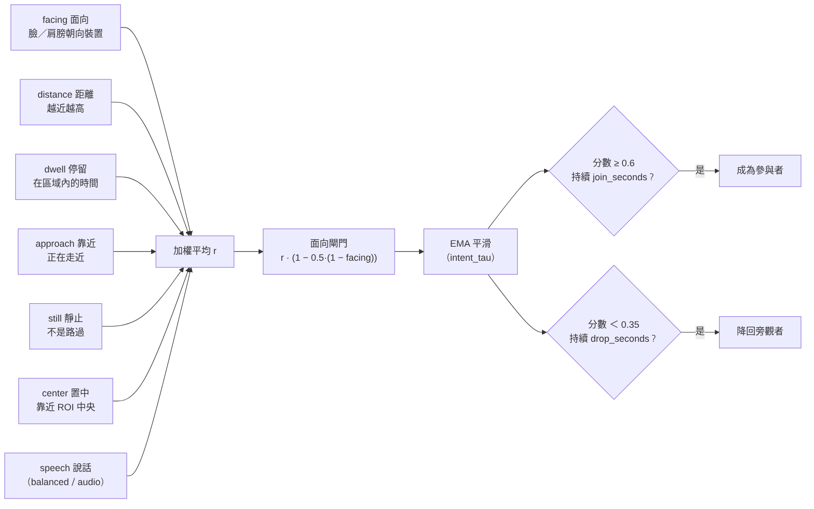
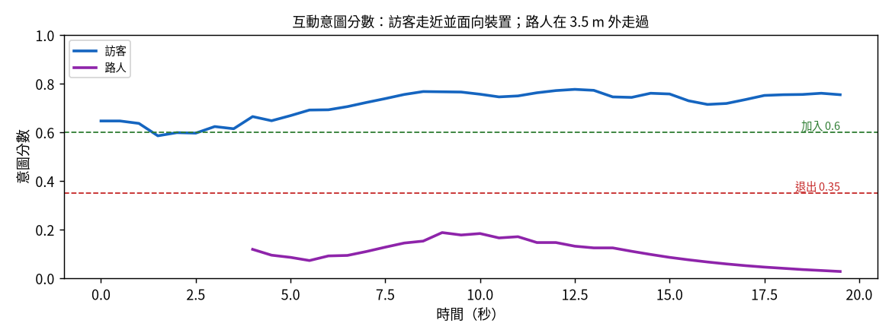

[English](../intent.md) · **繁體中文**

# 互動意圖：誰想說話？

鏡頭前的人不一定都在對話中。等在後面的同事、旁邊滑手機的人、路過的人：如果他們算參與者，結束的對話永遠不會結束，
路人也可能開啟對話。

所以每個 track 都有一個**角色**：`participant`（參與者）或 `bystander`（旁觀者）。只有參與者能讓 session 繼續。
用 `intent_model` 選擇判斷方式。

## `rules`：在 ROI 裡的時間

臉（或身體，見 `roi_rule`）在 ROI 內持續 `join_seconds`（2 s），而且偵測有信心、不會太遠，就成為參與者。
簡單、好預測，但分不出「在看」和「想用」。

## `score`：0 到 1 的意圖分數

```mermaid
flowchart LR
  F[面向] --> W[加權平均]
  DI[距離] --> W
  DW[停留] --> W
  AP[走近] --> W
  ST[靜止] --> W
  CE[置中] --> W
  SP[說話] --> W
  W --> G[面向閘門] --> E[EMA 平滑] --> J{≥ 0.6 持續 join_seconds？} --> P[參與者]
  E --> DR{＜ 0.35 持續 drop_seconds？} --> B[旁觀者]
```

### 線索

每個線索都是 0（沒有互動跡象）到 1（強烈跡象）之間的數字：

| 線索 | 怎麼量 | 權重（預設） |
|---|---|---|
| **facing 面向** | 臉部特徵點：鼻子在雙眼中間 → 1，轉頭 → 0。有姿勢時和肩膀朝向平均；沒有臉時只看肩膀。 | `w_facing` 0.45 |
| **distance 距離** | 在對話區內（≤ `zone_max`）= 1，到 `leave_distance` 線性降到 0。距離關閉時略過。 | `w_distance` 0.10 |
| **dwell 停留** | 在 ROI 內的秒數 ÷ 4，最高 1。 | `w_dwell` 0.10 |
| **approach 走近** | 0.5 + 4 × 身體每秒的相對變大比例，限制在 0–1。變大 = 走近。 | `w_approach` 0.05 |
| **still 靜止** | 1 − 橫向速度 ÷ 每秒 0.12 個畫面寬。路過 → 0。 | `w_still` 0.15 |
| **center 置中** | 1 − 和 ROI 中心的正規化距離（垂直方向算一半）。 | `w_center` 0.15 |
| **speech 說話** | 有人在說話，*而且*可以合理歸給這個人（唯一的候選人，或唯一面向裝置的人）時 = 1。否則不計入，不會扣分。 | vision / balanced / audio 分別是 0.05 / 0.15 / 0.25 |

### 從線索到分數

1. 有值的線索做**加權平均**：`r = Σ wᵢ·cueᵢ / Σ wᵢ`。缺少的線索直接略過，權重自動重新正規化。
2. **面向閘門**：`r_g = r × (1 − 0.5 × (1 − facing))`。背對裝置的人即使在中間站很久，分數也不會高。
3. 依實際時間**平滑**：`score ← score + (r_g − score) × (1 − e^(−dt / intent_tau))`，`intent_tau` = 1 s，和 fps 無關。
   沒看到某個 track 時，分數會用 4 倍的時間常數慢慢往 0 掉。

### 例子

一位訪客站在 ROI 中間、距離 1 m、面向裝置、靜止 4 秒。除了走近（0.5，已經不動）之外，線索都接近 1：
`r ≈ (0.45 + 0.1 + 0.1 + 0.025 + 0.15 + 0.15) / 1.0 ≈ 0.97`。面向 ≈ 1，閘門幾乎不改變分數。
一個在 3.5 m 外側身走過的人：面向 ≈ 0、靜止 ≈ 0、距離 0 → `r ≈ 0.2`，經過閘門後 ≈ 0.1。

下圖是真正的追蹤器在合成情境上的結果：一位訪客走近，一位路人在遠處走過。

預設權重下的典型分數（評估情境的中位數）：

| 情況 | 分數 | 結果 |
|---|---|---|
| 正面站著，稍微偏離中間 | ≈ 0.77 | 加入 |
| 站在邊緣看，臉偏、肩膀側面 | ≈ 0.42 | 不加入 |
| 在附近背對著滑手機 | ≈ 0.27 | 不加入；原本是參與者的話，8 秒後降為旁觀者 |
| 側身走過的路人 | ≈ 0.06 | 不加入 |

### 分數的用途

- **加入**：分數 ≥ `join_threshold`（0.6）持續 `join_seconds`，期間有偵測到而且不會太遠。
- **開始 session**：ENDED 時，要有人達到加入條件。balanced / audio 模式仍然可以用說話開始。
- **降級**：參與者在看得到的情況下，分數低於 `drop_threshold`（0.35）持續 `drop_seconds`（8 s），就降為旁觀者。
  **最後一位參與者不會被降級**：他有沒有離開由在場層判斷。
- **在場（HMM）**：群組機率只看參與者，旁觀者不能讓 session 一直持續。`intent_weighted_presence` 另外把每位參與者的
  證據乘上 `min(1, 分數 / 0.6)`。
- **NEW_GROUP**：新來的人也必須達到加入條件。

## 合成情境的結果

和三種 `rules` 組合相比（每個情境 20 個種子）：

- **誤加入**（路人、旁觀者、滑手機的人）：從 60 次降到 **0**。
- **參與者離開、旁觀者留下**：rules 版本都沒有結束 session（20 次中 20 次）；`score` 在 **5.0 秒**後判定 AWAY。
- **代價**：走近並說話的新來者要約 3.0 秒才加入，rules 是 2.0 秒（要先走近、轉正、等分數穩定）。
- 其他情境沒有退步。

**限制。** 站在正中間、盯著裝置但其實不想說話的人，仍然會被當成參與者：只看影像沒辦法讀心。評估中旁觀者的姿勢是設定好的；
請在介面上觀察意圖條（滑鼠移到上面可以看到每個線索），了解實際的分布。

## 調整建議

- 加入太慢 → 調低 `join_threshold`（例如 0.55）或 `intent_tau`。
- 旁觀者仍然會加入 → 調高 `w_facing` 或 `join_threshold`。
- 側著臉說話的人被降級 → 調高 `drop_seconds` 或調低 `drop_threshold`。
