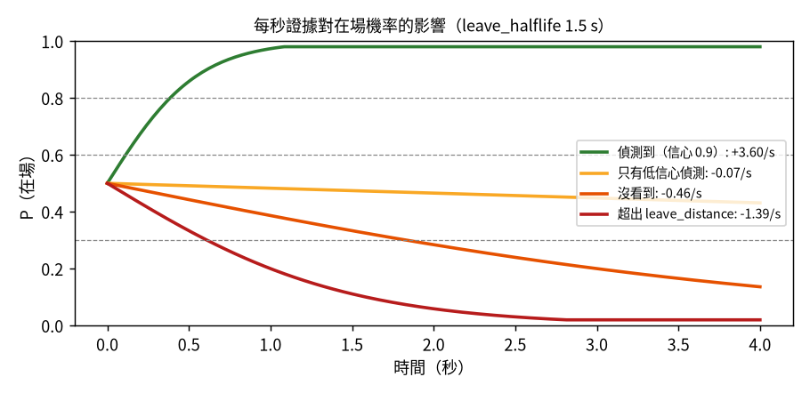
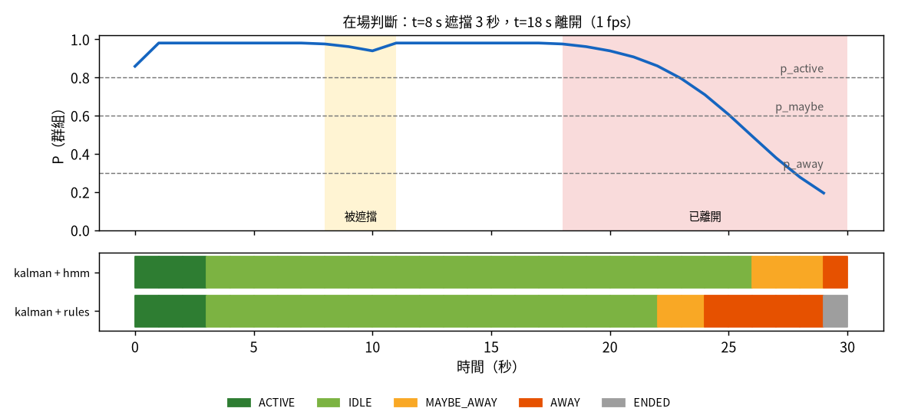

[English](../presence.md) · **繁體中文**

# 在場判斷：這群人還在嗎？

偵測結果會閃爍：暗的畫面漏掉一張臉、有人轉頭、有人從鏡頭前走過。在場層把這些每張畫面都不太可靠的證據，
變成一個穩定的訊號交給狀態機。用 `presence_model` 選擇。

## `rules`：計數和逾時

- 連續 `present_frames`（2）張畫面 ROI 內有信心足夠的參與者 → **有人**。
- 連續 `absent_frames`（3）張沒有 → **空**。
- 只有低信心偵測的畫面是**不確定**：影像棄權，改由聲音決定。

接著狀態機依這個路徑和 `priority_mode` 套用靜默逾時（見[狀態機](state-machine.md#rules-模式的逾時)）。
容易理解，但每漏一張都算數，偵測器一閃爍就可能誤判 MAYBE_AWAY，甚至 AWAY。

## `hmm`：每個人一個機率

想法：替每個人維持一個信念「這個人還在的可能性有多高？」，每張畫面更新一次。好的證據讓它快速上升；
沒有證據時慢慢流失；薄弱的證據幾乎不影響。決策用有遲滯的門檻，所以狀態不會來回跳。

### 兩行看懂對數勝算

模型存的不是機率 *P*，而是**對數勝算** `L = ln(P / (1 − P))`。*L* 加上 `ln 2 ≈ 0.69`，「在場」的勝算就變成兩倍。
這樣更新只是一個加法：

```
L ← clip(L + rate × dt, −3.9, +3.9)
```

`dt` 是和上一張畫面的實際時間差，所以 0.5 fps 和 2 fps 的結果一樣。上下限把 *P* 限制在 0.02 到 0.98，
站了一小時的人也不會變得「不可能判定離開」。

這就是連續時間版的兩狀態隱藏式馬可夫模型（在場／離開）：流失對應狀態轉移（「人可能走了」），證據對應觀測的似然比。

### 證據（每秒）

令 `λ = ln 2 / leave_halflife`（1.5 s → λ ≈ 0.46 / s）：

| 這張畫面對這個 track 的觀測 | rate | 意思 |
|---|---|---|
| 偵測到（臉或身體），信心 *c* | `+detect_gain × c`（4 × 0.9 = +3.6） | 看到了：信念快速上升 |
| 只有 Kalman 預測（延續中） | `−λ × (1 − vis_conf)` | 剛消失：幾乎不變；之後接近「沒看到」 |
| 沒配到，但這張畫面有低信心偵測 | `−λ × lowconf_factor`（0.15） | 接近中立：光線差不代表人走了 |
| 完全沒看到 | `−λ` | 勝算每 `leave_halflife` 減半 |
| 轉身**而且**正在遠離 | `−λ`（即使有偵測到） | 往「離開」推 |
| 超出 `leave_distance` | `−3λ` | 強烈往「離開」推 |

新的 track 從 P = 0.5 開始，再加上半秒的證據。



這張圖可以這樣讀：完全沒看到時，一個很確定的人（P = 0.98）大約 10 秒會掉到 0.3 以下；只有低信心偵測時大約慢 7 倍；
站在 `leave_distance` 外則快 3 倍。

### 群組機率

1. **影像部分** `P_影像`：參與者中最大的 P（還沒有參與者時，用所有 track 中最大的）。已經達到加入條件的穩定新來者
   也會算進來，避免在 NEW_GROUP 接手前先掉到 AWAY。
2. **聲音部分** `A`：加在群組對數勝算上的微弱全域偏移。聲音不會歸到任何一個人。
   - 說話時：`A = w_說話 × 5`
   - 靜默時：`A = −w_靜默 × 6 × min(1, 靜默秒數 / base_timeout)`

   | `priority_mode` | w_說話 | w_靜默 | 效果 |
   |---|---|---|---|
   | vision | 0.05 | 0 | 聲音幾乎沒影響；安靜站在畫面裡的人不會被判定離開 |
   | balanced | 0.8 | 0.8 | 說話可以撐住 session；有人在場但長時間靜默時會慢慢結束 |
   | audio | 1.0 | 1.0 | 主要看說話 |

3. `P_群組 = sigmoid(logit(P_影像) + A)`。

### 狀態（含遲滯）

| 條件 | 結果 |
|---|---|
| `P_群組 < p_away`（0.3）持續 `away_hold_seconds`（1 s） | **AWAY** |
| `P_群組 < p_maybe`（0.6），或已經是 MAYBE_AWAY 而且 `P_群組 < p_active`（0.8） | **MAYBE_AWAY** |
| 其他 | **ACTIVE**（最近有說話）或 **IDLE**（安靜達 `idle_after`） |
| 在 AWAY 而且 `P ≥ p_active` | 回到 **ACTIVE**。vision 模式只看 `P_影像`，聲音不能讓人「回來」 |
| AWAY 持續 `end_after_away` | **ENDED**（和 rules 相同） |

0.6（進入 MAYBE_AWAY）和 0.8（離開 MAYBE_AWAY）之間的差距就是遲滯：機率在 0.6 附近徘徊時，狀態不會一直跳。

## 兩種模型的比較

真正的追蹤器，合成情境，1 fps：t = 8 s 遮擋 3 秒，t = 18 s 人離開。



- 遮擋期間 HMM 幾乎不動（0.98 → 0.94）。在目前的預設值下，rules 也撐過了這次遮擋。
- 真的離開後，rules 約 4 秒進入 MAYBE_AWAY，HMM 約 8 秒。這是穩定的代價：`leave_halflife` 減半，HMM 就快一倍。

`scripts/eval_tracking.py` 的結果（每個情境 20 個種子加總；量測時用的是較早的預設值 `leave_halflife` 0.6 s、`min_conf` 0.6）：

| 情境 | legacy+rules | kalman+rules | kalman+hmm |
|---|---|---|---|
| 低信心閃爍（40% 畫面信心 0.4）：誤判 AWAY | 27 | 27 | **0** |
| 同上：誤判 MAYBE_AWAY | 13 | 13 | **5** |
| 同上：每分鐘狀態切換 | 7.5 | 7.5 | **2.2** |
| 遮擋 1–3 s，1 fps：誤判 MAYBE_AWAY | 20 | 20 | **0** |
| 慢慢離開（6 秒內轉身、變小）：離開判定 | 11.0 s | 12.0 s | **7.9 s** |
| 舊的人離開 2 秒後，新的人站到同一位置：誤判 MAYBE_AWAY | 0 | 0 | 20 |
| 所有情境合計誤判 MAYBE_AWAY / AWAY | 53 / 27 | 53 / 27 | **25 / 0** |

HMM 唯一看起來比較差的情境其實可以說是對的：原本的使用者真的走了，HMM 在 NEW_GROUP 開新 session 之前短暫反映了這件事。

## 該用哪一個？

- 先用 `kalman` + `hmm`（+ `score` 意圖），也就是「推薦」預設組合，並觀察介面上的**在場機率**圖。
- 太慢發現離開 → 調低 `leave_halflife`；太多誤判 MAYBE_AWAY → 調高。
- 光線差、偵測信心低 → `lowconf_factor` 保持小，讓薄弱的畫面維持中立。
