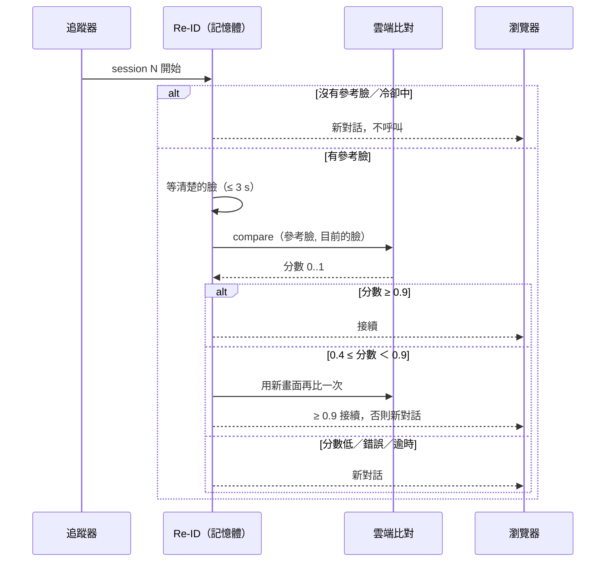
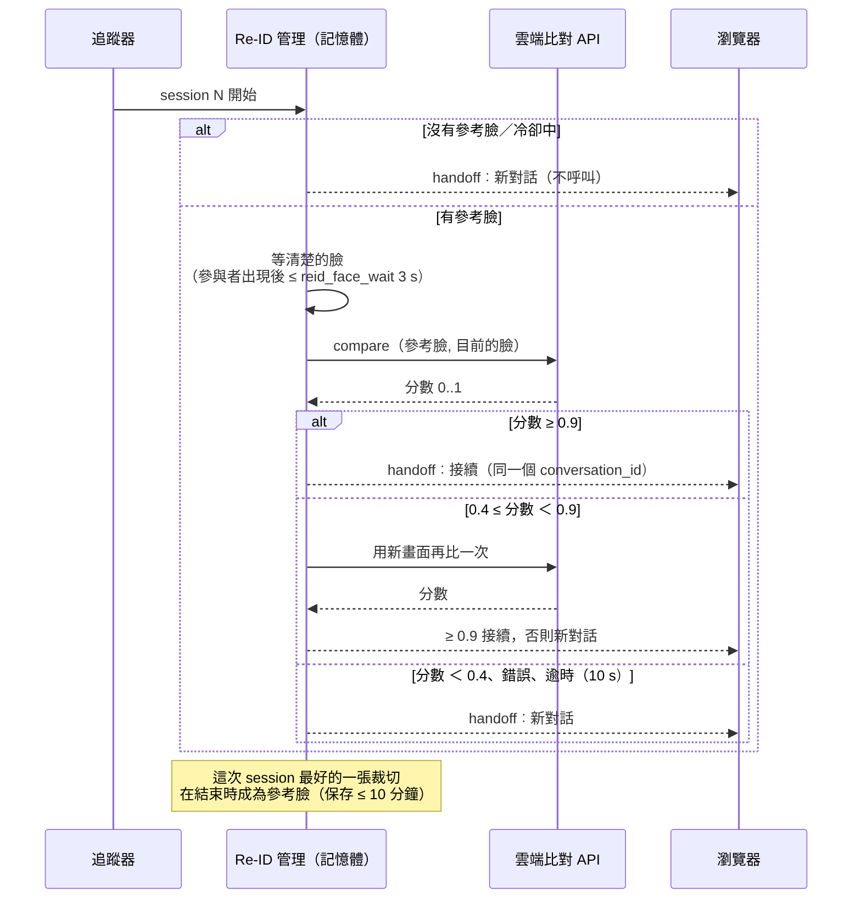

[English](../reid.md) · **繁體中文**

# Re-ID：是上一位使用者嗎？（選用）

> **預設關閉。** 開啟後，人臉裁切會**離開裝置**送到第三方雲端服務，而且伺服器會在**記憶體中**短暫保存最近幾位使用者的
> 臉部裁切。請先閱讀下方的隱私說明。

## 用途

在場追蹤開啟**新的 session** 時，下游的對話系統常常想知道：是上一位使用者回來了（接續對話），還是新的人（重新開始）？
Re-ID 做這個判斷並輸出 `conversation_id`：

- **同一人** → 沿用上一個 `conversation_id`（`decision: resume`）；
- **不同人、不確定或任何失敗** → 新的 `conversation_id`（`decision: new`）。

presence-demo 本身沒有對話記憶。「接續」只代表「同一個 ID」，要怎麼使用由下游系統決定。session 進行中從不呼叫服務；
沒有保存中的參考臉時也不呼叫。

## 怎麼判斷





1. **等可用的臉。** 第一位參與者要露出清楚的臉（正面或稍微側面，寬度 ≥ `reid_min_face`，畫面的 6%）。
   參與者出現後 `reid_face_wait`（3 s）內沒有，就判定 `new`（`no_face_timeout`）。整段等待上限是
   `reid_decision_timeout`（10 s），MAYBE_AWAY 或 AWAY 期間暫停計時。
2. **比對**保存中的參考臉，最新的優先，最多 `reid_max_refs`（3）位。
3. **判斷**：
   - 分數 ≥ `reid_threshold`（0.9）→ `resume`（`match`）；
   - `reid_uncertain_low`（0.4）≤ 分數 < 0.9 → 用新畫面再比一次，然後 `resume` 或 `new`（`uncertain`）；
   - 低於 0.4 → `new`（`below_threshold`）；
   - 逾時、HTTP 錯誤、沒有 key、達到上限、斷路器開啟 → `new`（`error`、`no_key`、`cap`、`breaker`）。
4. session 進行中，伺服器保留這位使用者**品質最好**的一張臉部裁切；session 結束時，它成為下一次比對的參考臉。

判斷在背景執行，不會延遲 session 開始、影像或聲音。`reid_cooldown`（5 s）內連續重新開始的 session 直接判定 `new`，不呼叫。
呼叫次數有每小時（`reid_cap_per_hour`）和每個連線（`reid_cap_total`）上限。

為什麼是 0.9？在隨機 100 對 LFW 照片上，內建服務的 AUC 是 0.992；門檻 0.9 時**沒有誤認**，誤拒率 14%。
錯誤的「接續」（把兩位使用者的對話混在一起）比錯誤的「新對話」嚴重，所以門檻設得很嚴。

## 輸出

```json
{"type": "handoff", "session": 12, "conversation_id": "3f…", "decision": "resume",
 "resumed_from_session": 11, "score": 0.94, "reason": "match", "calls": 3}
```

`conversation_id` 是隨機 UUID，和身分沒有關聯。每秒一次的 `{"type": "reid"}` 狀態（階段、參考臉數量、剩餘時間、
呼叫次數、tokens、估計費用）不含影像。

## 隱私：記憶體中的例外

伺服器的原則是不保存任何影像。Re-ID 必須記住臉，所以有一個明文例外：

| 項目 | 規則 |
|---|---|
| 保存什麼 | 每位使用者一張臉部裁切（320 × 320 JPEG），從不保存整張畫面。 |
| 保存在哪 | 伺服器程序記憶體，綁定在那個 WebSocket 連線。不寫磁碟、暫存檔、日誌或 `/debug`。 |
| 保存多久 | `reid_ttl`，預設也是上限 **600 秒（10 分鐘）**；最多 `reid_max_refs` 位。 |
| 何時清除 | 到期、關閉功能、設定中的「清除參考臉」、`reset`、`POST /api/reid_reset`、斷線、伺服器關閉。 |
| 送給誰 | 選定的雲端服務，每次比對送兩張裁切。 |
| 啟用條件 | `reid_enabled` **和** `reid_consent`（預設都關閉）。 |
| 顯示縮圖 | 開啟 `reid_show_crops`（「顯示比對照片」）時，每次判斷後把比對的臉縮成 112 × 112，只送到**這個瀏覽器**顯示在比對卡片（最近 4 筆，瀏覽器記憶體）。從不寫入磁碟、日誌、診斷事件、`/debug` 或錄音，並和參考臉一起清除。 |

人臉在許多地區屬於受特別規範的生物特徵資料（例如 GDPR 第 9 條、台灣個人資料保護法）。部署時請告知現場的人、
依規定取得同意、確認雲端服務的資料保存政策，並考慮設定更短的 `reid_ttl`。

## 後端

介面是 `presence_demo.reid.CloudReid.compare(reference_jpeg, query_jpeg) -> (score, meta)`，新增服務只需要實作這個方法。
內建後端呼叫 Typesafe「Jev」影像比對 API。API key 來自環境變數 `TYPESAFE_API_KEY` 或設定頁的密碼欄位（`POST /api/reid_key`），
只存在記憶體，不寫日誌、不回傳。測試或 proxy 可以用 `REID_JEV_URL` 改端點。
