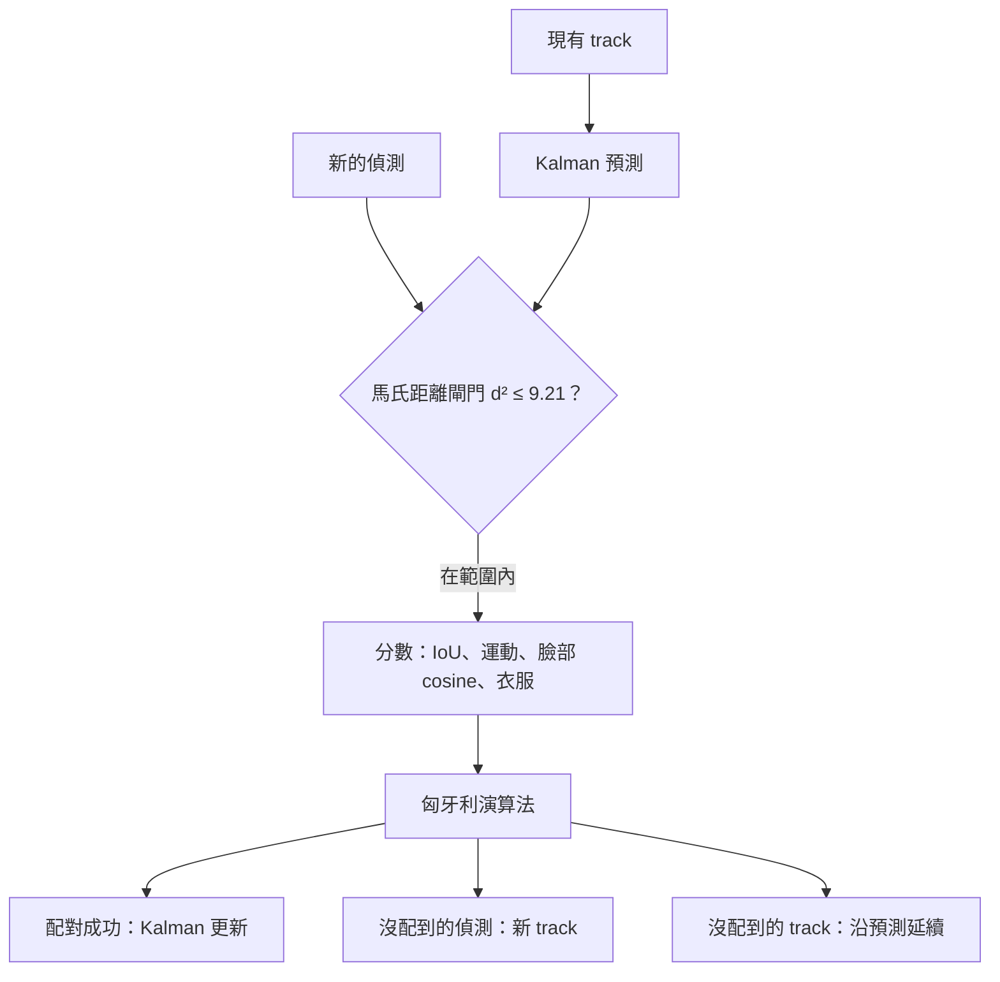
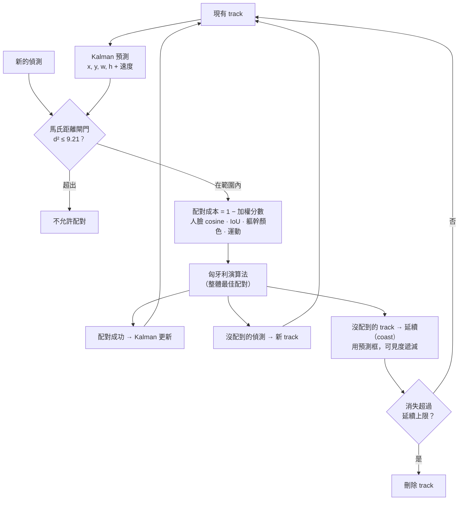

[English](../tracking.md) · **繁體中文**

# 追蹤

偵測告訴我們*這一張畫面裡臉在哪裡*；追蹤回答*隨著時間，誰是誰*。沒有追蹤，每張畫面都是一群陌生人，
也沒辦法計時（「她已經在這裡 2 秒了嗎？」）。

每個人有一個 **track**：編號、框、慢慢更新的臉部特徵模板（`embed_ema` 0.15）和各種計時器。沒看到的 track 會保留
`grace_seconds`（15 s），短暫被擋住不會變成新的人。用 `tracker_mode` 選擇演算法。

## `legacy`：貪婪配對

對每一組（偵測, track）：

1. 計算臉部 cosine `cos` 和框重疊 `IoU`（缺臉時改用身體框）；
2. 符合以下任一條件才接受：`cos ≥ cos_match`；或 `IoU ≥ iou_match` 且 `cos ≥ cos_weak`；或其中一邊沒有臉且 `IoU ≥ iou_match`；
3. 依 `cos + 0.5 · IoU` 排序，從最好的開始逐一配對。

簡單，看得到臉時效果很好。弱點：兩個都看不到臉的人互換位置時，只靠重疊分不出來，編號就會互換。

## `kalman`：預測、閘門、整體配對、延續

**1. 預測。** 每個 track 有一個等速 Kalman 濾波器，狀態有 8 個數字：框的中心、寬、高 `(cx, cy, w, h)` 和它們的速度。
用的是實際的時間差，所以 0.5 fps 和 2 fps 都能正確預測。直覺：「她每秒往左走畫面的 10%，所以 1 秒後應該再往左 10%。」

**2. 閘門。** 預測帶有不確定性。**馬氏距離**衡量一個偵測在這個不確定性下有多「意外」。
`d² > gate_mahalanobis`（9.21，自由度 2 的卡方分布 99% 點）*而且*框沒有重疊、*而且*臉也沒有強烈相符時，就不允許配對。
臉部判定不同（`cos < cos_weak`），或沒有臉時衣服判定不同（顏色相似度 < `appearance_min_sim` 0.6），也不允許。

**3. 分數。** 剩下的每一組，用有資料的項目做加權平均：

| 項目 | 值 | 權重 |
|---|---|---|
| 框重疊 | 預測框和偵測框（或身體框）的 IoU | 1 |
| 運動一致 | `exp(−d² / gate)` | 1 |
| 臉部相似度 | `cos / cos_match`，最高 1 | 2 |
| 衣服顏色 | `(相似度 − 0.5) / 0.5`，限制在 0–1 | 1.5 |

分數 ≥ 0.3 才可以配對，代價是 `1 − 分數`。

**4. 整體配對。** **匈牙利演算法**找出總代價最低的配對組合。貪婪配對可能先做了一個「還不錯」的選擇，
逼得後面只能配錯；匈牙利演算法不會。（程式自己實作，不需要 SciPy，並和暴力搜尋比對測試過。）

**5. 延續（coasting）。** 沒配到的 track 會沿著預測位置繼續移動 `coast_seconds`（2 s），可見度逐漸下降：
`vis_conf = 1 − 消失秒數 / coast_seconds`。`vis_conf ≥ coast_present_conf`（0.4，約前 1.2 s）時仍然算有人。
延續中的 track 不會累積加入時間，也不算 NEW_GROUP 的新來者。

狀態輸出中每個 track 有 `visible_kind`（`detected` / `predicted` / `none`）、`vis_conf` 和 `velocity`。

## 合成情境的結果

`scripts/eval_tracking.py` 用真正的追蹤器跑設計好的情境（每個情境 20 個隨機種子），加總結果：

| 情境 | 模式 | ID 互換 | 斷裂 | 誤判 MAYBE_AWAY | 離開判定 |
|---|---|---|---|---|---|
| 遮擋 1–3 s，2 fps | legacy | 0 | 0 | 20 | — |
| | kalman | 0 | 0 | **0** | — |
| 兩人互換位置、看不到臉 | legacy | 38 | 38 | 0 | — |
| | kalman | **0** | **0** | 0 | — |
| 交錯走過、側身、fps 變動、換新的人 | 兩者 | 0 | 0 | 0 | — |
| 人離開 | legacy | 0 | 0 | 0 | 5.0 s |
| | kalman | 0 | 0 | 0 | 6.0 s |

解讀：

- Kalman 消除了看不到臉時的編號互換，也能撐過短暫遮擋。
- 代價是「離開」判定慢約 **1 秒**，因為延續中的 track 還算有人。如果這比較重要，可以調低 `coast_seconds` 或調高
  `coast_present_conf`。
- 額外的計算（每人一個小直方圖，以及 ≤ 6 人的匈牙利演算法）不到 0.5 ms。

**限制。** 這是合成情境，雜訊和衣服分布都是假設的。兩個人衣服相似又都看不到臉時仍然困難。請先用自己的錄影確認，
再依賴這些數字。
